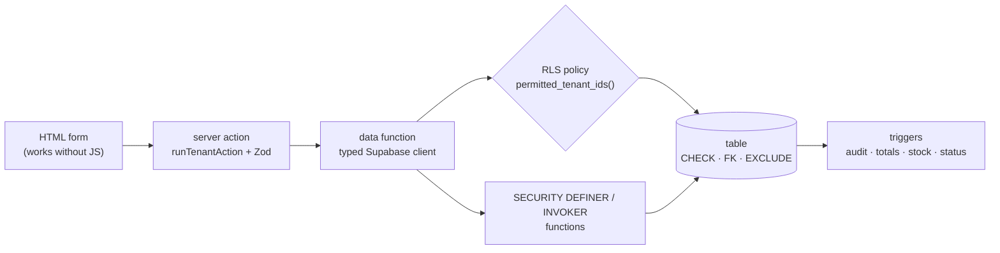
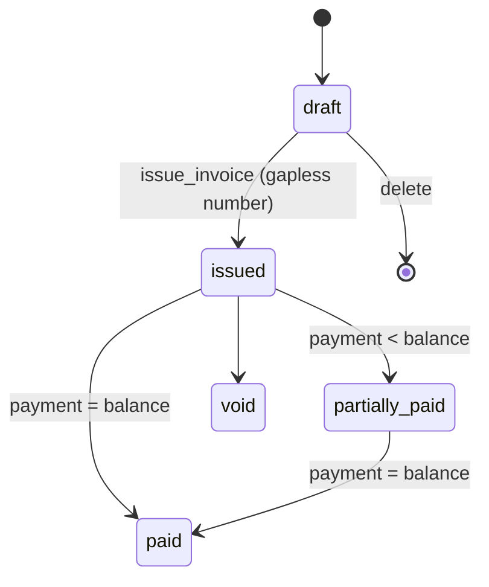
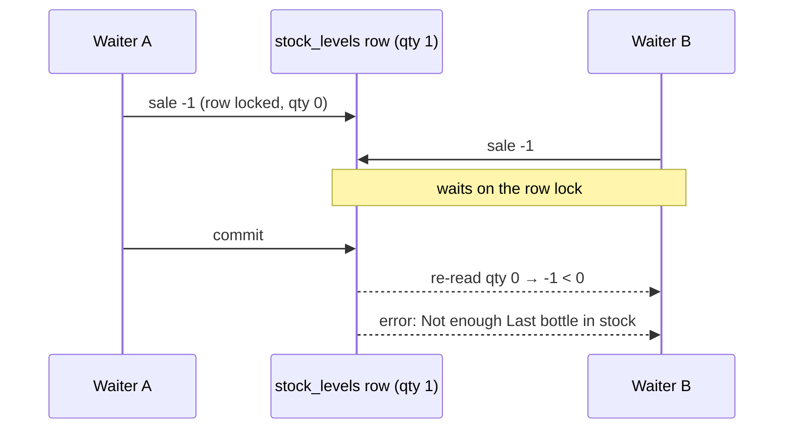

# Learning from Kitto

Kitto pushes most business rules into Postgres and keeps the TypeScript thin. This guide walks through the techniques that make that work, with short snippets from the real code and a link to where each one lives. Read it alongside [docs/ARCHITECTURE.md](docs/ARCHITECTURE.md), which explains _what_ the modules do; this file explains _how_.

Snippets are excerpts: `-- ...` or `// ...` marks lines left out. Migration paths are given in the package that owns them; `pnpm db:sync` copies them into `supabase/`.



**SQL**

1. [Row level security with one permission helper](#1-row-level-security-with-one-permission-helper)
2. [SECURITY DEFINER with an empty search_path](#2-security-definer-with-an-empty-search_path)
3. [Composite tenant foreign keys](#3-composite-tenant-foreign-keys)
4. [Column-level grants](#4-column-level-grants)
5. [An audit trigger with before and after jsonb](#5-an-audit-trigger-with-before-and-after-jsonb)
6. [No double bookings: tstzrange and an exclusion constraint](#6-no-double-bookings-tstzrange-and-an-exclusion-constraint)
7. [Free slots with generate_series and multiranges](#7-free-slots-with-generate_series-and-multiranges)
8. [Recurring bookings with a recursive CTE](#8-recurring-bookings-with-a-recursive-cte)
9. [Gapless invoice numbers](#9-gapless-invoice-numbers)
10. [Append-only ledgers and derived status](#10-append-only-ledgers-and-derived-status)
11. [No negative stock under concurrency](#11-no-negative-stock-under-concurrency)
12. [Idempotent callbacks with hashed tokens](#12-idempotent-callbacks-with-hashed-tokens)
13. [Gap-filled report series](#13-gap-filled-report-series)
14. [Testing the database with pgTAP](#14-testing-the-database-with-pgtap)

**TypeScript**

15. [Generated database types](#15-generated-database-types)
16. [Parsing FormData with Zod](#16-parsing-formdata-with-zod)
17. [Server actions with runTenantAction](#17-server-actions-with-runtenantaction)
18. [Progressive enhancement](#18-progressive-enhancement)
19. [Per-request caching with React cache()](#19-per-request-caching-with-react-cache)
20. [Composing modules with sections](#20-composing-modules-with-sections)
21. [Realtime refresh](#21-realtime-refresh)
22. [Server-rendered SVG charts](#22-server-rendered-svg-charts)
23. [Discriminated unions for configuration](#23-discriminated-unions-for-configuration)
24. [Pure tenant resolution](#24-pure-tenant-resolution)
25. [Playwright and axe](#25-playwright-and-axe)

---

## SQL

### 1. Row level security with one permission helper

Every table has `tenant_id`, and every policy asks the same question: "is this row's tenant one where I hold permission _x_?" One function answers it.

```sql
-- packages/core/supabase/migrations/20260101000300_core_permissions.sql
create function private.permitted_tenant_ids(p_permission text)
returns setof uuid
language sql
stable
security definer
set search_path = ''
as $$
  select m.tenant_id
  from public.tenant_members m
  join public.roles r on r.id = m.role_id
  where m.user_id = (select auth.uid())
    and m.status = 'active'
    and (
      (r.key = 'owner' and r.is_system)
      or exists (
        select 1 from public.role_permissions rp
        where rp.role_id = r.id and rp.permission_key = p_permission
      )
    );
$$;
```

Policies use it as an uncorrelated sub-select:

```sql
-- packages/customers/supabase/migrations/20260102000100_customers.sql
create policy "customers.view reads customers"
  on public.customers for select to authenticated
  using (tenant_id in (select private.permitted_tenant_ids('customers.view')));
```

Why this shape:

- **`tenant_id in (select ...)`** is not correlated with the row, so Postgres runs the function **once per statement**, not once per row. A per-row `has_permission(tenant_id, 'x')` would be correct but slow on big tables.
- **`(select auth.uid())`** is wrapped in a sub-select for the same reason: it becomes an init plan evaluated once.
- **Owners always pass**, so a new permission added by a module never locks an owner out.
- `public.has_permission(tenant, key)` is the same check as a boolean, for functions and the UI.

Permissions are data, not code. A module registers them with default roles in its migration:

```sql
select private.register_permission('customers.view', 'customers', 'View customers and their history',
  array['manager', 'front_desk', 'waiter', 'sales', 'viewer']);
```

### 2. SECURITY DEFINER with an empty search_path

`permitted_tenant_ids` reads `tenant_members` and `roles`, which have RLS policies of their own that call... `permitted_tenant_ids`. Running it as `security definer` (as the function owner) skips those policies and avoids infinite recursion.

A definer function runs with more rights than its caller, so it must not be fooled by objects the caller creates. Every function in Kitto sets `search_path = ''` and schema-qualifies everything (`public.tenant_members`, `auth.uid()`). A caller who creates their own `tenant_members` table in another schema cannot hijack the lookup.

Two more habits go with it:

- Function privileges are explicit. Default `execute` is revoked, then granted to the roles that need it:

  ```sql
  revoke all on function private.permitted_tenant_ids(text) from public, anon, authenticated;
  grant execute on function private.permitted_tenant_ids(text) to authenticated, service_role;
  ```

- Helpers live in the `private` schema, which the API does not expose. `public` functions are the API.

Most business functions are the opposite, `security invoker`, so the caller's RLS applies and the function is a convenience, never a way around permissions (see the header of `packages/booking/supabase/migrations/20260103000200_booking_functions.sql`). `pnpm db:lint` runs `plpgsql_check` over all of them.

### 3. Composite tenant foreign keys

RLS stops you _reading_ another tenant's customer, but could a booking in tenant A _point at_ a customer in tenant B if someone guessed the id? Not with composite keys:

```sql
-- packages/customers/supabase/migrations/20260102000100_customers.sql
create table public.customers (
  id           uuid primary key default gen_random_uuid(),
  tenant_id    uuid not null references public.tenants (id) on delete cascade,
  -- ...
  -- Target for composite foreign keys from other modules: (tenant_id, customer_id)
  -- guarantees a booking can only point at a customer of the same tenant.
  unique (tenant_id, id)
);
```

```sql
-- packages/booking/supabase/migrations/20260103000100_booking.sql
  foreign key (tenant_id, resource_id) references public.resources (tenant_id, id),
  foreign key (tenant_id, customer_id) references public.customers (tenant_id, id),
```

The pair `(tenant_id, customer_id)` must exist together, so cross-tenant references are impossible by construction. A `prevent_tenant_change` trigger on every table stops rows from being moved between tenants afterwards.

### 4. Column-level grants

The client may insert and update customers, but only some columns. `created_by`, `created_at` and `archived_at` on insert are the database's business:

```sql
-- packages/customers/supabase/migrations/20260102000100_customers.sql
revoke all on public.customers, public.customer_notes from anon, authenticated;
grant select, delete on public.customers to authenticated;
grant insert (tenant_id, name, phone, email, tags, notes, attributes) on public.customers to authenticated;
grant update (name, phone, email, tags, notes, attributes, archived_at) on public.customers to authenticated;
```

`tenant_id` is in the insert grant but not the update grant. Tables whose status must only change through a function (invoices, orders, M-Pesa requests) simply do not grant `update (status)`.

### 5. An audit trigger with before and after jsonb

One generic trigger function audits any table. `to_jsonb(old)` and `to_jsonb(new)` snapshot the whole row, and a `jsonb_each` diff lists what changed:

```sql
-- packages/core/supabase/migrations/20260101000400_core_audit.sql
  v_old jsonb := case when tg_op in ('UPDATE', 'DELETE') then to_jsonb(old) end;
  v_new jsonb := case when tg_op in ('INSERT', 'UPDATE') then to_jsonb(new) end;
  -- ...
  v_claims jsonb := nullif(current_setting('request.jwt.claims', true), '')::jsonb;
begin
  if tg_op = 'UPDATE' then
    select coalesce(array_agg(n.key order by n.key), '{}')
      into v_changed
    from jsonb_each(v_new) n
    where n.key <> 'updated_at'
      and n.value is distinct from v_old -> n.key;
    if cardinality(v_changed) = 0 then
      return null;
    end if;
  end if;
```

- The actor comes from the JWT claims PostgREST puts in `request.jwt.claims`, so it is recorded even inside `security definer` functions.
- Updates that change nothing are not logged.
- A module turns it on with one line: `select private.enable_audit('public.customers');`.

### 6. No double bookings: tstzrange and an exclusion constraint

A reservation stores its time as one value, a range, instead of two columns:

```sql
-- packages/booking/supabase/migrations/20260103000100_booking.sql
  during         tstzrange not null,
  -- Generated copies of the range bounds: easy to sort, filter and index.
  starts_at      timestamptz generated always as (lower(during)) stored,
  ends_at        timestamptz generated always as (upper(during)) stored,
  -- ...
  -- THE double-booking guard.
  constraint reservations_no_overlap exclude using gist (
    resource_id with =,
    during      with &&
  ) where (private.reservation_blocks(status)),
```

An exclusion constraint is a generalised unique constraint: no two rows may have the same `resource_id` **and** overlapping (`&&`) periods. Notes:

- `btree_gist` (enabled in `20260101000100_core_foundation.sql`) lets one GiST index mix `=` on a uuid with `&&` on a range.
- Ranges are `[)`, start included and end excluded, so 10:00-11:00 and 11:00-12:00 do not clash.
- The `where` clause makes cancelled and no-show reservations stop blocking.
- Two people booking the same slot at the same instant cannot both win; the loser gets SQLSTATE `23P01`, which `commonErrorCode` turns into `?error=conflict` and the booking form shows as "That time is already booked. Pick another time or resource."

```mermaid
gantt
  dateFormat HH:mm
  axisFormat %H:%M
  section Room 101
  Booked (confirmed)        :done, 10:00, 60m
  Fits: starts as one ends  :active, 11:00, 60m
  section Refused
  Overlaps 10:30 (23P01)    :crit, 10:30, 60m
```



### 7. Free slots with generate_series and multiranges

`available_slots` lists free start times for a resource on a day. It builds the free time with multirange arithmetic (Postgres 14+), then walks a grid with `generate_series` and keeps candidates that fit:

```sql
-- packages/booking/supabase/migrations/20260103000200_booking_functions.sql
  free as (
    select range_agg(o.w) - coalesce((select r from busy), '{}'::tstzmultirange) as r
    from open_windows o
  )
  select gs, gs + dur.d
  from open_windows o
  cross join dur
  cross join free
  cross join lateral generate_series(lower(o.w), upper(o.w) - dur.d,
                                     make_interval(mins => greatest(p_step_minutes, 5))) as gs
  where tstzrange(gs, gs + dur.d, '[)') <@ free.r
    and gs >= now()
  order by 1;
```

`range_agg(open hours) - range_agg(busy)` is the free time as a set of ranges; `<@` asks "is this candidate contained in it?". Opening hours are local wall-clock times turned into instants with `(p_day + h.opens) at time zone res.tz`, so daylight saving is handled by Postgres.

### 8. Recurring bookings with a recursive CTE

"Every Tuesday at 10:00, ten times" is generated in SQL and inserted in **one statement**, so a clash with any occurrence rolls back the whole series:

```sql
-- packages/booking/supabase/migrations/20260103000200_booking_functions.sql
  with recursive occurrence (n, local_start) as (
    select 1, p_starts_local
    union all
    select o.n + 1, o.local_start + p_every
    from occurrence o
    where o.n < p_occurrences
  )
  insert into public.reservations
    (tenant_id, resource_id, customer_id, series_id, during, guests, title, notes, status)
  select v_tenant, p_resource_id, p_customer_id, v_series,
         tstzrange(o.local_start at time zone v_tz,
                   (o.local_start + make_interval(mins => p_duration_minutes)) at time zone v_tz, '[)'),
         -- ...
  from occurrence o;
```

The series is stepped in **local** time (`timestamp`, not `timestamptz`) and only converted at the end, so "10:00" stays 10:00 across a daylight-saving change.

### 9. Gapless invoice numbers

Tax authorities want INV-00001, INV-00002, ... with no gaps. A sequence cannot do it (rolled-back transactions burn values). A counter row can:

```sql
-- packages/billing/supabase/migrations/20260104000100_billing.sql
create table private.billing_counters (
  tenant_id   uuid not null references public.tenants (id) on delete cascade,
  kind        text not null check (kind in ('invoice', 'quote')),
  last_value  bigint not null check (last_value > 0),
  primary key (tenant_id, kind)
);

create function private.next_document_number(p_tenant_id uuid, p_kind text)
-- ...
  insert into private.billing_counters as c (tenant_id, kind, last_value)
  values (p_tenant_id, p_kind, 1)
  on conflict (tenant_id, kind) do update set last_value = c.last_value + 1
  returning c.last_value into v_next;
  return case p_kind when 'quote' then 'QUO-' else 'INV-' end || lpad(v_next::text, 5, '0');
```

The upsert locks the tenant's counter row until the issuing transaction ends. Concurrent issues queue; a rolled-back issue rolls the counter back too. Drafts have no number, so the lock is held only for the moment of issuing. The counter is per tenant, so tenants never wait for each other.

### 10. Append-only ledgers and derived status

Money and stock are never edited, only appended. Payments refuse updates and deletes:

```sql
-- packages/billing/supabase/migrations/20260104000100_billing.sql
create function private.payments_append_only()
-- ...
  raise exception 'Payments cannot be changed or deleted; void the invoice instead' using errcode = '22023';
```

Totals and statuses are **derived** from the ledger by triggers, never typed in. Before a payment, the invoice row is locked and the amount checked against the balance; after it, the status follows from the arithmetic:

```sql
-- packages/billing/supabase/migrations/20260104000100_billing.sql (check_payment)
  select * into v_inv from public.invoices
  where id = new.invoice_id and tenant_id = new.tenant_id
  for update;
  -- ...
  if new.amount_minor > v_inv.total_minor - v_inv.paid_minor then
    raise exception 'Payment exceeds the balance due' using errcode = '22023';
  end if;
```

```sql
-- (apply_payment)
  update public.invoices i
  set paid_minor = i.paid_minor + new.amount_minor,
      status = case
        when i.paid_minor + new.amount_minor >= i.total_minor then 'paid'
        else 'partially_paid'
      end
  where i.id = new.invoice_id;
```

The same idea runs through the codebase:

- Line amounts are `generated always as (...) stored` columns; document totals are kept in step by triggers. Money is integer minor units (`bigint`), so there is no floating point anywhere.
- `stock_movements` is the stock ledger (`packages/inventory/supabase/migrations/20260106000100_inventory.sql`); `stock_levels` is a summary maintained only by its trigger, and the `item_stock` view derives `on_hand` and `low`.



### 11. No negative stock under concurrency

Two waiters sell the last bottle at the same moment. Only one may succeed. The stock trigger upserts the level row and checks the result:

```sql
-- packages/inventory/supabase/migrations/20260106000100_inventory.sql
  insert into public.stock_levels as s (tenant_id, item_id, location_id, quantity, updated_at)
  values (new.tenant_id, new.item_id, new.location_id, new.quantity, now())
  on conflict (item_id, location_id)
  do update set quantity = s.quantity + excluded.quantity, updated_at = now()
  returning s.quantity into v_level;

  if v_level < 0 and new.quantity < 0 then
    select * into v_item from public.items i where i.id = new.item_id;
    if not v_item.allow_negative then
      -- ...
      raise exception 'Not enough % in stock at %', v_item.name, v_where
        using errcode = '22023', hint = 'insufficient_stock';
```

The upsert takes a row lock. The second sale waits; when the first commits, READ COMMITTED re-reads the locked row, sees zero, and the second sale fails.

Operations that move several items at once (sending an order, a transfer) could deadlock if two of them lock rows in different orders. So they lock **in a fixed order** first:

```sql
-- packages/inventory/supabase/migrations/20260106000100_inventory.sql (lock_stock_levels)
  for v_pair in
    select distinct (e ->> 'item_id')::uuid as item_id, (e ->> 'location_id')::uuid as location_id
    from jsonb_array_elements(p_pairs) e
    order by 1, 2
  loop
    -- ...
    perform 1 from public.stock_levels s
    where s.item_id = v_pair.item_id and s.location_id = v_pair.location_id
    for update;
  end loop;
```



### 12. Idempotent callbacks with hashed tokens

Safaricom calls back with the result of an M-Pesa payment. The callback has no user session, may arrive twice, and must not be forgeable.

- Each request gets a fresh random token. The token goes into the callback URL (`/api/mpesa/callback/<token>`); the database stores only its SHA-256 hash. A database leak does not reveal valid callback URLs.
- The callback looks the request up by hash, **locks it**, and returns early if it is already settled, so replays change nothing.

```sql
-- packages/mpesa/supabase/migrations/20260105000100_mpesa.sql
  select * into v_req from public.mpesa_requests
  where callback_token_hash = encode(sha256(convert_to(p_token, 'UTF8')), 'hex')
  for update;
  if not found then
    raise exception 'Payment request not found' using errcode = 'P0002';
  end if;
  -- Idempotent: anything already settled is acknowledged and left alone.
  if v_req.status not in ('pending', 'expired') then
    return 'duplicate';
  end if;
```

Money that cannot be applied (the invoice was paid in cash meanwhile, or the amount differs) is never dropped: the request becomes `needs_review` for a person to refund or apply.

### 13. Gap-filled report series

A revenue chart should show a zero on a quiet day, not skip it. Reports start from a `generate_series` of every bucket and `left join` the data onto it:

```sql
-- packages/reports/supabase/migrations/20260108000200_reports_billing.sql
  with buckets as (
    select b::date as bucket
    from generate_series(
      case when v_week then date_trunc('week', p_from::timestamp) else p_from::timestamp end,
      p_to::timestamp,
      case when v_week then interval '1 week' else interval '1 day' end) as b
  ),
  -- invoiced as (...), paid as (...)
  select b.bucket, coalesce(i.amount, 0)::bigint, coalesce(pd.amount, 0)::bigint
  from buckets b
  left join invoiced i on i.bucket = b.bucket
  left join paid pd on pd.bucket = b.bucket
  order by b.bucket;
```

Payments are bucketed by the **tenant's** local day (`p.received_at at time zone v_timezone`), so a payment at 00:30 Nairobi time counts on the right day.

### 14. Testing the database with pgTAP

Every module ships tests in `packages/<module>/supabase/tests/`, run by `pnpm db:test`. Each file runs in a transaction that is rolled back. Small helpers impersonate users by setting the JWT claims that `auth.uid()` reads, then switch to the `authenticated` role so RLS applies:

```sql
-- packages/customers/supabase/tests/customers_test.sql
create or replace function tests.login(p_uid uuid, p_email text) returns void
language sql as $$
  select set_config('request.jwt.claims',
    json_build_object('sub', p_uid, 'role', 'authenticated', 'email', p_email)::text, true);
$$;
-- ...
select tests.login('a1000000-0000-0000-0000-000000000002', 'desk-a@cust.test');
set local role authenticated;
-- ...
select throws_ok(
  $$insert into public.customers (tenant_id, name, phone) values (current_setting('tests.a')::uuid, 'Dup', '+254712345678')$$,
  '23505', null, 'phone numbers are unique per tenant'
);
```

Assert on **SQLSTATE codes** (`23505` unique, `23P01` exclusion, `42501` permission, `22023` business rule), not messages, so wording can change freely.

Concurrency cannot be tested in one session. `packages/inventory/supabase/tests/inventory_concurrency_test.sql` opens two real sessions with `dblink`, has A sell the last bottle and hold its transaction, sends B's sale asynchronously, and checks B is blocked:

```sql
select extensions.dblink_exec('a', 'begin');
select extensions.dblink_exec('a', current_setting('tests.sell'));

-- B tries to sell it too, asynchronously.
select extensions.dblink_send_query('b', current_setting('tests.sell'));
select pg_sleep(0.5);
select is(extensions.dblink_is_busy('b'), 1, 'the second sale waits for the first (row lock on the level)');

select extensions.dblink_exec('a', 'commit');
select * from extensions.dblink_get_result('b', false) as r(status text);
select matches(
  extensions.dblink_error_message('b'),
  'Not enough Last bottle in stock',
  'once the first commits, the second sees no stock left and is refused'
);
```

dblink sessions commit for real, so the test uses a throwaway tenant and deletes it at the end.

---

## TypeScript

### 15. Generated database types

`pnpm db:types` (`scripts/gen-types.mjs`) runs `supabase gen types` against the local database and writes `packages/core/src/database.types.ts`. Every module's client is typed with it:

```ts
// packages/core/src/data.ts
export type KittoClient = SupabaseClient<Database>;
```

```ts
// packages/billing/src/data.ts
export type Invoice = Tables<'invoices'>;
type GeneratedLineAmounts = 'line_subtotal_minor' | 'line_tax_minor' | 'line_total_minor';
/** Generated (stored, not-null inputs) columns are never null, whatever the types say. */
export type InvoiceLine = Omit<Tables<'invoice_lines'>, GeneratedLineAmounts> &
  Record<GeneratedLineAmounts, number>;
```

Rename a column and `pnpm typecheck` points at every query that uses it. CI runs `pnpm db:types:check` to fail when the committed file is stale. The `Omit<...> & Record<...>` trick corrects a type the generator cannot know (generated columns are reported as nullable).

### 16. Parsing FormData with Zod

Forms post strings. A Zod schema turns those strings into clean, typed values, mirroring the database rules so users get a message before a round trip (the database checks again regardless):

```ts
// packages/customers/src/schemas.ts
/** A customer as typed into a form: every field is a string. */
export const customerFormSchema = z.object({
  name: z.string().trim().min(1, 'Enter a name').max(120, 'Keep the name under 120 characters'),
  phone: z
    .string()
    .trim()
    .refine((v) => v === '' || normalizePhone(v) !== null, 'Enter a valid phone number')
    .transform((v) => (v === '' ? null : normalizePhone(v))),
  // ...
  tags: z
    .string()
    .transform(parseTags)
    .refine((t) => t.length <= 20, 'Use at most 20 tags')
    .refine((t) => t.every((tag) => tag.length <= 40), 'Keep each tag under 40 characters'),
  notes: z.string().trim().max(2000, 'Keep notes under 2,000 characters'),
});
export type CustomerInput = z.output<typeof customerFormSchema>;
```

`z.output` is the type _after_ transforms (`phone: string | null`, `tags: string[]`), which is what the data functions accept.

### 17. Server actions with runTenantAction

Every mutation follows one recipe, in `packages/auth/src/server.ts`:

```ts
export async function runTenantAction(
  formData: FormData,
  permission: string | readonly string[],
  page: string,
  work: (ctx: TenantContext) => Promise<ActionOutcome>,
  classify: (e: unknown) => string = commonErrorCode,
): Promise<never> {
  const slug = formData.get('tenant');
  if (typeof slug !== 'string' || !slug) notFound();
  const ctx = await getTenantContext(slug);
  requirePermission(ctx, ...(typeof permission === 'string' ? [permission] : permission));
  let outcome: ActionOutcome;
  try {
    outcome = await work(ctx);
  } catch (e) {
    outcome = { error: classify(e) };
  }
  // ... revalidatePath, then redirect with ?notice= or ?error=
}
```

A module action is then a few lines:

```ts
// packages/customers/src/actions.ts
export async function createCustomerAction(formData: FormData): Promise<void> {
  await runTenantAction(
    formData,
    P.create,
    '/customers/new',
    async (ctx) => {
      const parsed = customerFormSchema.safeParse(customerFields(formData));
      if (!parsed.success) return { error: customerFormError(parsed.error) };
      const customer = await createCustomer(ctx.db, ctx.tenant.id, parsed.data);
      return { notice: 'created', path: `/customers/${customer.id}` };
    },
    customerErrorCode,
  );
}
```

- The permission check is a friendly early 404; RLS is the real enforcement.
- Database errors are classified by SQLSTATE into short codes (`exists`, `forbidden`, `conflict`, ...) and shown by `Flash` from a per-module message table. Error text from Postgres never reaches the page.
- The outcome is a redirect with `?notice=` or `?error=`: the Post/Redirect/Get pattern, so refresh never resubmits.

### 18. Progressive enhancement

Forms are plain `<form action={serverAction}>` with a hidden tenant field. They work before JavaScript loads, or without it:

```tsx
// packages/customers/src/pages.tsx
<form action={createCustomerAction} className="space-y-6">
  <TenantField slug={ctx.tenant.slug} />
  <CustomerFields />
  <div className="flex flex-wrap gap-3">
    <SubmitButton pendingLabel="Saving…">Add customer</SubmitButton>
```

`TenantField` is `<input type="hidden" name="tenant" value={slug} />` (`packages/ui/src/components.tsx`). `SubmitButton` (`packages/ui/src/client.tsx`) is the only client component in the form: with JavaScript it uses `useFormStatus` to show "Saving…" and prevent double submits; without it, it is an ordinary button. Pages are server components; client components are small islands (theme toggle, live refresh, confirm dialogs).

### 19. Per-request caching with React cache()

The tenant layout, the page, and several cards on it all need the tenant context. `cache()` makes them share one load per request:

```ts
// packages/auth/src/server.ts
/**
 * Load the tenant named in the URL for the signed-in user. Users who are not
 * an active member get a 404 (we don't reveal which tenants exist).
 * Cached per request, so layouts and pages can both call it.
 */
export const getTenantContext = cache(async (slug: string): Promise<TenantContext> => {
```

The cache lives only for one server request, so there is no cross-user leakage and nothing to invalidate. Components can call `getTenantContext` freely instead of threading props through every level.

### 20. Composing modules with sections

Modules must not import each other in a cycle: booking cannot depend on orders _and_ orders on booking. Yet the reservation page should show the orders charged to it and its invoice. The fix is a `sections` prop: the module renders slots, the **app** fills them.

```tsx
// packages/booking/src/pages.tsx
sections?: ((reservation: ReservationRow) => ReactNode)[];
```

```tsx
// apps/demo/src/app/t/[tenant]/bookings/[id]/page.tsx
<ReservationDetailPage
  ctx={ctx}
  searchParams={await searchParams}
  reservationId={id}
  // Orders and billing compose in here; booking itself depends on neither.
  sections={[
    (r) => (
      <ReservationOrders
        ctx={ctx}
        reservationId={r.id}
        canAdd={r.status !== 'cancelled' && r.status !== 'no_show'}
      />
    ),
    (r) => <ReservationBilling ctx={ctx} r={r} />,
  ]}
/>
```

Customers, invoices and orders pages take `sections` the same way. In SQL the matching trick is a generic `(source_type, source_id)` pair: an invoice can bill a `reservation` or an `order` without billing knowing either exists.

### 21. Realtime refresh

Pages are server-rendered, so how does the front desk see a booking made on another screen? A tiny client component subscribes to Postgres changes and asks Next.js to re-render the server components:

```tsx
// packages/booking/src/live.tsx
const channel = db
  .channel(`kitto:${table}:${tenantId}`)
  .on(
    'postgres_changes',
    { event: '*', schema: 'public', table, filter: `tenant_id=eq.${tenantId}` },
    () => {
      // A recurring booking inserts many rows at once: refresh once.
      clearTimeout(timer.current);
      timer.current = setTimeout(() => router.refresh(), 300);
    },
  )
  .subscribe();
```

Realtime applies RLS, so users only hear about rows they could read. The event carries no data the page uses; `router.refresh()` re-fetches through the normal, permission-checked path. Billing uses the same pattern so an invoice turns **Paid** the moment the M-Pesa callback lands.

### 22. Server-rendered SVG charts

Reports draw charts as plain SVG in server components: no chart library, no client JavaScript.

```tsx
// packages/reports/src/charts.tsx
/*
 * Charts drawn as plain SVG on the server: no chart library and no client
 * JavaScript. Every chart is a <figure> holding
 *
 *   - an <svg role="img"> named by its <title> and described by its <desc>
 *     (a one-sentence summary such as "Collected KES 9,000 over 7 days"),
 *   - a visible caption and legend (aria-hidden: the table repeats them),
 *   - a visually hidden <table> with every number, for screen readers.
 * ...
 */
```

The geometry (`barRects`, `linePath`, `donutArcs`, `niceCeiling`) lives in `packages/reports/src/math.ts` as pure functions with unit tests. Colours are the theme's CSS variables, so charts follow the tenant theme and dark mode for free.

### 23. Discriminated unions for configuration

M-Pesa can be off, mocked, or live. Each mode needs different settings, and a union on `mode` makes invalid combinations unrepresentable:

```ts
// packages/mpesa/src/config.ts
export type MpesaConfig =
  | { mode: 'disabled' }
  | { mode: 'mock'; callbackBaseUrl: string }
  | {
      mode: 'sandbox' | 'production';
      consumerKey: string;
      consumerSecret: string;
      shortcode: string;
      passkey: string;
      callbackBaseUrl: string;
    };
```

After `if (config.mode === 'mock') ...`, TypeScript knows there are no credentials; in the live branch it knows all of them are strings. `readMpesaConfig` validates the environment once and names (never prints) missing values, and refuses `mock` on a production Vercel deployment. Small unions do the same job elsewhere, e.g. `ActionOutcome` is `{ notice } | { error }`.

### 24. Pure tenant resolution

Which tenant a request is for is a pure function of host and path, so it runs in the proxy (middleware), in server components and in unit tests alike:

```ts
// packages/core/src/tenant-resolution.ts
/**
 * Tenant resolution: work out which tenant a request is for.
 *
 *   subdomain mode   acme.example.com/bookings   -> slug "acme", path "/bookings"
 *   path mode        example.com/t/acme/bookings -> slug "acme", path "/bookings"
 * ...
 */
export function resolveTenant(
  config: TenantResolutionConfig,
  host: string,
  pathname: string,
): ResolvedTenant | null {
```

In subdomain mode the proxy (`packages/auth/src/proxy.ts`) rewrites `acme.example.com/x` to `/t/acme/x`, so one set of route files serves both modes. Links are built with `ctx.path()` (`tenantPath`), never by hand. Resolving a slug only says which tenant the URL _names_; access is still RLS.

### 25. Playwright and axe

End-to-end tests in `apps/demo/e2e/` drive the real app against the local Supabase stack, signing in through Mailpit. They run on a phone (Pixel 7) and a desktop project. The accessibility sweep visits every page at three widths, in light and dark, and runs axe-core against WCAG 2.1 A/AA:

```ts
// apps/demo/e2e/a11y.spec.ts
const WIDTHS = [360, 768, 1440] as const;
const SCHEMES = ['light', 'dark'] as const;

async function sweep(page: Page, paths: string[]) {
  for (const width of WIDTHS) {
    await page.setViewportSize({ width, height: 900 });
    for (const colorScheme of SCHEMES) {
      await page.emulateMedia({ colorScheme });
      for (const path of paths) {
        // ...
        const { violations } = await new AxeBuilder({ page })
          .withTags(['wcag2a', 'wcag2aa', 'wcag21a', 'wcag21aa'])
          .analyze();
        // ...
        if (width === 360) await expectNoSideScroll(page);
```

- `expect.soft` collects every violation across the sweep instead of stopping at the first.
- At 360px it also asserts there is no sideways scrolling, which catches most mobile layout bugs.
- Tests find elements by role and label (`getByRole('button', { name: 'Add customer' })`), the way assistive technology does, so a test failing often means an accessibility bug.

The module generator is tested the same way: `pnpm generator:check` generates a throwaway module, runs its pgTAP, unit and Playwright tests, then removes it.
