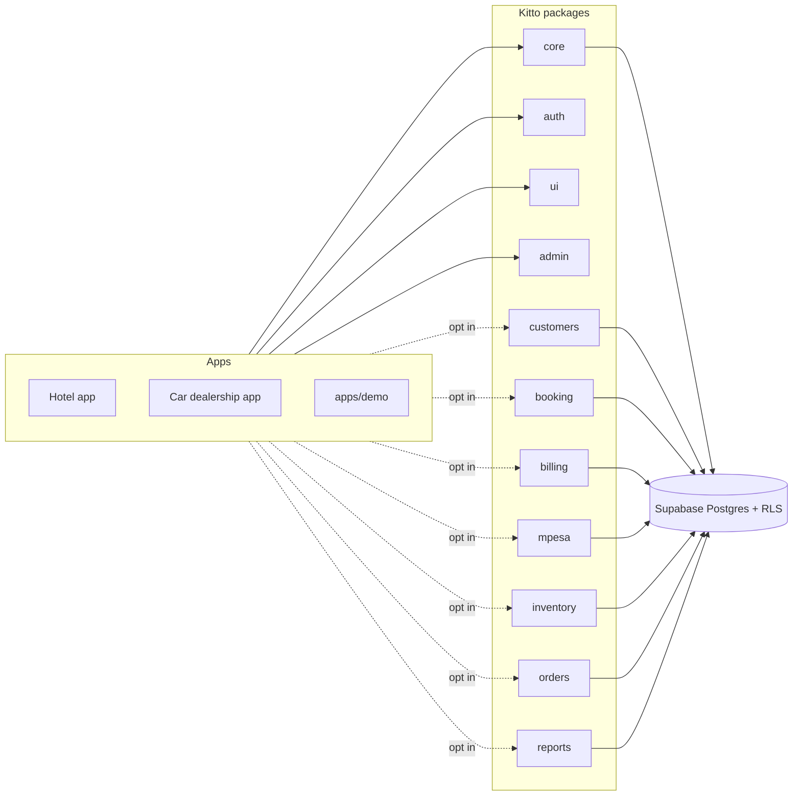

# Kitto

**Kitto** (kit + to) is a reusable framework for multi-tenant business apps, built on Next.js (App Router), strict TypeScript and Supabase (Postgres, Row Level Security, Realtime). It packages the parts every business app needs, such as tenants, staff roles, customers, bookings, billing, M-Pesa, stock and orders, so a new app like a hotel system or a car dealership is mostly configuration and a few screens.



## Status

| Step | Scope                                                                         | State   |
| ---- | ----------------------------------------------------------------------------- | ------- |
| 1    | Monorepo, CI, database core (tenants, members, roles/permissions, RLS, audit) | ✅      |
| 2    | auth, ui kit, admin portal shell                                              | planned |
| 3    | customers, booking                                                            | planned |
| 4    | billing, mpesa                                                                | planned |
| 5    | inventory, orders                                                             | planned |
| 6    | reports, module generator                                                     | planned |
| 7    | demo app, docs and tutorial                                                   | planned |

## Layout

```
supabase/          generated: every module's migrations + pgTAP tests (pnpm db:sync)
packages/
  core             tenants, members, roles & permissions, audit log, formatting
  ...              one package per module (see docs/ARCHITECTURE.md)
tools/             create-kitto-module generator
apps/demo          example app using every module
docs/              architecture, setup, tutorial
scripts/           sync-sql, gen-types
```

## Quick start

Prerequisites: Node 22, pnpm 10, Docker (for local Supabase).

```bash
pnpm install
pnpm db:start        # local Supabase on ports 553xx (avoids clashing with other projects)
pnpm db:test         # pgTAP: RLS, tenant isolation, permissions, audit
pnpm test            # unit tests
```

Common scripts:

| Script                             | What it does                                                            |
| ---------------------------------- | ----------------------------------------------------------------------- |
| `pnpm db:sync`                     | Copy each package's `supabase/{migrations,tests}` into root `supabase/` |
| `pnpm db:reset`                    | Rebuild the local database from migrations                              |
| `pnpm db:lint`                     | `supabase db lint`                                                      |
| `pnpm db:types`                    | Regenerate `packages/core/src/database.types.ts`                        |
| `pnpm typecheck` / `lint` / `test` | Across all packages via Turborepo                                       |

## Key ideas

- **Tenant isolation lives in the database.** Every tenant-owned table has `tenant_id` and RLS policies driven by `has_permission(tenant_id, 'module.action')`. pgTAP tests prove one tenant cannot read or write another's rows.
- **Roles are data.** Seven default roles are seeded per tenant (owner, manager, front_desk, waiter, storekeeper, sales, viewer), and tenants can add their own. Owners hold every permission and the last owner cannot be removed, disabled or demoted.
- **Everything important is audited** by one generic trigger that records who, what, when, and the before and after values.
- **Modules are opt-in.** Each package owns ordered, append-only migrations, typed data access, Zod schemas, UI and tests.

Read [docs/ARCHITECTURE.md](docs/ARCHITECTURE.md) for the design and diagrams.
