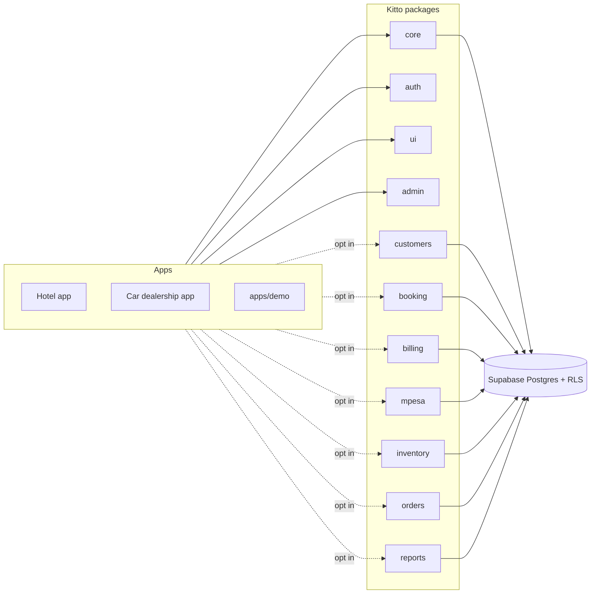

# Kitto

**Kitto** (kit + to) is a reusable framework for multi-tenant business apps, built on Next.js (App Router), strict TypeScript and Supabase (Postgres, Row Level Security, Realtime). It packages the parts every business app needs, such as tenants, staff roles, customers, bookings, billing, M-Pesa, stock and orders, so a new app like a hotel system or a car dealership is mostly configuration and a few screens.



## Status

| Step | Scope                                                                         | State |
| ---- | ----------------------------------------------------------------------------- | ----- |
| 1    | Monorepo, CI, database core (tenants, members, roles/permissions, RLS, audit) | ✅    |
| 2    | auth, ui kit, admin portal shell                                              | ✅    |
| 3    | customers, booking                                                            | ✅    |
| 4    | billing, mpesa                                                                | ✅    |
| 5    | inventory, orders                                                             | ✅    |
| 6    | reports, module generator                                                     | ✅    |
| 7    | demo app, docs and tutorial                                                   | ✅    |

## Modules

| Package            | What it gives you                                                                                                              | Permissions                                                     |
| ------------------ | ------------------------------------------------------------------------------------------------------------------------------ | --------------------------------------------------------------- |
| `@kitto/core`      | tenants, members, roles as data, `has_permission` + RLS helpers, generic audit trigger, money/date formatting, typed DB client | `tenant.manage`, `members.manage`, `roles.manage`, `audit.view` |
| `@kitto/auth`      | magic-link sign-in, proxy (session + path/subdomain tenant resolution), `getTenantContext`, `runTenantAction`, invitations     | –                                                               |
| `@kitto/ui`        | accessible (WCAG AA) mobile-first components, themes + dark mode, forms, data tables, flash messages, per-tenant currency      | –                                                               |
| `@kitto/admin`     | admin portal pages: staff and invitations, roles editor, workspace settings (theme, currency, time zone), audit log            | (uses the core permissions)                                     |
| `@kitto/customers` | customers with search, notes timeline, archive; `sections` slots for other modules                                             | `customers.view/create/edit/delete`                             |
| `@kitto/booking`   | resources (rooms, bays, tables) with hours and rates, double-booking-proof reservations, slots, recurring series, agenda       | `booking.view/create/manage/configure`                          |
| `@kitto/billing`   | quotes and invoices with gapless numbers, tax, payments, derived status, PDFs, billing any source (reservation, order)         | `billing.view/create/issue/void`, `payments.record`             |
| `@kitto/mpesa`     | Daraja STK push for invoices, idempotent callbacks with hashed per-request tokens, mock mode for dev and CI                    | `mpesa.request`                                                 |
| `@kitto/inventory` | items, suppliers, locations, purchases, append-only stock ledger, no negative stock under concurrency, low-stock alerts        | `inventory.view/manage/purchase/adjust/transfer`                |
| `@kitto/orders`    | restaurant/bar/counter orders that take stock when sent, charge to a reservation, and become paid with their invoice           | `orders.view/create/serve/cancel/bill`                          |
| `@kitto/reports`   | revenue, payment methods, receivables aging, utilisation, top items, stock, new customers; server-rendered SVG charts          | `reports.view` + each module's `.view`                          |

Every app gets `core`, `auth`, `ui` and `admin`; the business modules are opt-in, and modules never import each other sideways except where the dependency is real (orders uses inventory; billing, booking and orders use customers; mpesa uses billing). The app composes them through `sections` props and generic sources. See the [dependency graph](docs/ARCHITECTURE.md#business-modules).

## Layout

```
supabase/          generated: every module's migrations + pgTAP tests (pnpm db:sync)
packages/
  core             tenants, members, roles & permissions, audit log, formatting
  auth             magic-link sign-in, proxy (tenant resolution), invitations, tenant switcher
  ui               themed, accessible components; dark mode; forms; data tables
  admin            admin portal pages: staff, roles, settings, audit log
  ...              one package per module (see docs/ARCHITECTURE.md)
tools/             create-kitto-module generator
apps/demo          example app using every module
apps/site          static docs and landing site (kitto.madebyfavor.com)
docs/              architecture, setup, tutorial (LEARNING.md at the root)
scripts/           sync-sql, gen-types
```

## Quick start

Prerequisites: Node 22, pnpm 10, Docker (for local Supabase).

```bash
pnpm install
pnpm db:start        # local Supabase on ports 553xx (avoids clashing with other projects)
pnpm db:test         # pgTAP: RLS, tenant isolation, permissions, audit
pnpm test            # unit tests
cp .env.example apps/demo/.env.local   # add the anon key from `pnpm exec supabase status`
pnpm --filter @kitto/demo dev          # http://localhost:3000; sign-in emails land in Mailpit (:55324)
```

Sign in with any email, create a workspace, then press **Load sample data** on the workspace home to get a small hotel with rooms, bookings, stock, orders and a part-paid invoice. See [apps/demo/README.md](apps/demo/README.md).

See [docs/SETUP.md](docs/SETUP.md) for subdomain mode, e2e tests, hosted Supabase, Vercel and M-Pesa (Daraja). Locally, `MPESA_ENV=mock` (the `.env.example` default) makes M-Pesa requests settle themselves a second later without touching Safaricom.

Common scripts:

| Script                             | What it does                                                              |
| ---------------------------------- | ------------------------------------------------------------------------- |
| `pnpm db:sync`                     | Copy each package's `supabase/{migrations,tests}` into root `supabase/`   |
| `pnpm db:reset`                    | Rebuild the local database from migrations                                |
| `pnpm db:lint`                     | `supabase db lint`                                                        |
| `pnpm db:types`                    | Regenerate `packages/core/src/database.types.ts`                          |
| `pnpm typecheck` / `lint` / `test` | Across all packages via Turborepo                                         |
| `pnpm create-kitto-module <name>`  | Scaffold a new module (see below)                                         |
| `pnpm generator:check`             | Generate a scratch module and prove it passes every check, then remove it |

## Create a module

```bash
pnpm create-kitto-module vehicles --fields "make:text! model:text! year:int price:money notes:longtext" --app apps/demo
pnpm install && pnpm db:sync && pnpm db:reset && pnpm db:types   # or add --apply
```

This writes `packages/vehicles` the same shape as `@kitto/customers`: a migration (tenant-scoped table, RLS, `vehicles.view/create/edit/delete` permissions, audit, column grants), a pgTAP test, Zod schemas, typed data access, server actions, list/new/detail pages and a Vitest file. With `--app` it also adds the routes, nav entry, `transpilePackages` entry, dependency and a Playwright spec. Use `--dry-run` to see the file list first. See [tools/create-kitto-module](tools/create-kitto-module/README.md).

## Key ideas

- **Tenant isolation lives in the database.** Every tenant-owned table has `tenant_id` and RLS policies driven by `has_permission(tenant_id, 'module.action')`. pgTAP tests prove one tenant cannot read or write another's rows.
- **Roles are data.** Seven default roles are seeded per tenant (owner, manager, front_desk, waiter, storekeeper, sales, viewer), and tenants can add their own. Owners hold every permission and the last owner cannot be removed, disabled or demoted.
- **Everything important is audited** by one generic trigger that records who, what, when, and the before and after values.
- **Modules are opt-in.** Each package owns ordered, append-only migrations, typed data access, Zod schemas, UI and tests.

## Testing

| Layer                | Tool                              | What it proves                                                                                                     |
| -------------------- | --------------------------------- | ------------------------------------------------------------------------------------------------------------------ |
| Database             | pgTAP (`pnpm db:test`)            | RLS and tenant isolation, the permission matrix per role, constraints, triggers, numbering, concurrency (`dblink`) |
| Database lint        | `pnpm db:lint`                    | plpgsql functions compile and reference real objects                                                               |
| Unit                 | Vitest (`pnpm test`)              | Zod schemas, money/tax maths, chart scales, tenant resolution, redirects, forms                                    |
| End to end           | Playwright (`apps/demo/e2e`)      | real sign-in through Mailpit, every module's main flow, M-Pesa mock, on a phone and a desktop viewport             |
| Accessibility        | `@axe-core/playwright`            | an axe sweep of every page (WCAG 2.1 AA) in light and dark mode                                                    |
| Generator            | `pnpm generator:check`            | a freshly generated module passes all of the above                                                                 |
| Generated SQL, types | `db:sync:check`, `db:types:check` | the root `supabase/` folder and `database.types.ts` match the packages                                             |

CI (GitHub Actions) runs these as the `check`, `db`, `e2e` and `generator` jobs.

## Documentation

The docs are also published, with rendered diagrams, at **[kitto.madebyfavor.com](https://kitto.madebyfavor.com)**.

- [docs/SETUP.md](docs/SETUP.md): local development, path or subdomain tenant URLs, Supabase cloud, Vercel, M-Pesa (Daraja), environment variables.
- [docs/TUTORIAL.md](docs/TUTORIAL.md): build "Kitto Garage", a small dealership and workshop, in an hour; plus how a hotel app maps onto the modules.
- [docs/ARCHITECTURE.md](docs/ARCHITECTURE.md): system and request diagrams, data model, tenancy, roles, every module's design.
- [LEARNING.md](LEARNING.md): the notable SQL and TypeScript techniques used, with real snippets.
- [apps/demo/README.md](apps/demo/README.md): the demo app and how modules are mounted.
- [apps/site/README.md](apps/site/README.md): the docs site, how it renders these files, and its demo screenshots.
