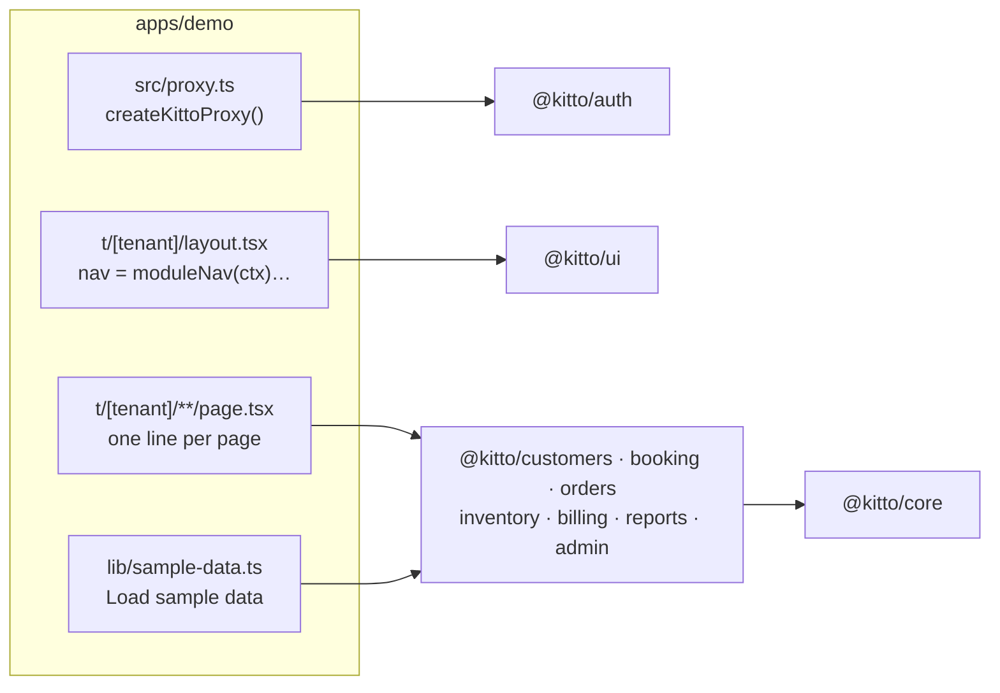

# Kitto demo

`@kitto/demo` is a Next.js app that uses every Kitto module. It is the reference for how an
app puts the framework together, and the app the end-to-end tests run against. It holds very
little code of its own: route files that mount module pages, a navigation list, a proxy, and
some sample data.



## Run it

You need Docker, Node 22 and pnpm 10. Full instructions are in [docs/SETUP.md](../../docs/SETUP.md).

```powershell
pnpm install
pnpm db:start                      # local Supabase in Docker; prints keys
Copy-Item .env.example apps/demo/.env.local   # then paste the anon and service keys
pnpm dev                           # http://localhost:3000
```

1. Open <http://localhost:3000> and choose **Sign in**.
2. Enter any email address. Local Supabase doesn't send mail; open Mailpit at
   <http://127.0.0.1:55324> and click the link.
3. Create a workspace. You are its owner.
4. On the workspace home, press **Load sample data**.

### Sample data

**Load sample data** appears on the workspace home while the workspace is empty (no customers,
resources or items) and the user holds every permission it needs (owners do). It adds a small
guest house:

| Module    | What it adds                                                                                    |
| --------- | ----------------------------------------------------------------------------------------------- |
| Customers | Achieng Otieno (tagged `vip`), Brian Kamau and Wanjiru Mwangi                                   |
| Booking   | Rooms 101 and 102 with nightly rates, a meeting room open Mon–Fri 08:00–18:00 at an hourly rate |
|           | A confirmed two-night stay, a tentative stay, and a weekly meeting repeated four times          |
| Inventory | A supplier, three drinks and a breakfast (not stock-tracked), and a received purchase           |
|           | Bottled water is bought below its reorder level, so it shows as low stock                       |
| Orders    | Room service charged to the stay, and a paid walk-in counter sale                               |
| Billing   | INV-00001 for the stay plus room service, issued, with a 4,500 cash deposit (part paid)         |

The code is in [`src/lib/sample-data.ts`](src/lib/sample-data.ts). It calls the modules' own
data functions as the signed-in user, so RLS, triggers and SQL rules apply just as they do for
the forms. Prices come from resource rates, stock from the received purchase, and the invoice
number from the gapless counter. Every row shows up in **Admin → Audit log**. The framework
packages contain no demo data; `supabase/seed.sql` is empty on purpose.

## How modules are mounted

Kitto modules ship pages as React server components. The app decides the URLs: each route
file loads the tenant context and renders a module page. Next.js expects one file per
route, so every page in the app is a thin file like this one,
[`src/app/t/[tenant]/customers/page.tsx`](src/app/t/[tenant]/customers/page.tsx):

```tsx
import type { Metadata } from 'next';
import { getTenantContext } from '@kitto/auth/server';
import { CustomersPage } from '@kitto/customers';

export const metadata: Metadata = { title: 'Customers' };

export default async function Page({ params, searchParams }: PageProps<'/t/[tenant]/customers'>) {
  return (
    <CustomersPage
      ctx={await getTenantContext((await params).tenant)}
      searchParams={await searchParams}
    />
  );
}
```

`getTenantContext` checks the user is signed in and a member of the workspace. It returns the
tenant, the user's role and permissions, a Supabase client bound to the user, and `path()` for
building links. Module pages check permissions themselves and render a friendly "not allowed"
message.

| Route folder (under `src/app/t/[tenant]/`)                                      | Module              |
| ------------------------------------------------------------------------------- | ------------------- |
| `page.tsx`, `actions.ts`                                                        | the demo's own home |
| `admin/` (staff, roles, settings, audit)                                        | `@kitto/admin`      |
| `customers/`, `customers/new`, `customers/[id]`                                 | `@kitto/customers`  |
| `bookings/`, `bookings/new`, `bookings/[id]`, `bookings/resources/…`            | `@kitto/booking`    |
| `orders/`, `orders/new`, `orders/[id]`                                          | `@kitto/orders`     |
| `inventory/` (items, suppliers, locations, purchases, movements, adjust, …)     | `@kitto/inventory`  |
| `invoices/`, `invoices/new`, `invoices/[id]`, `invoices/[id]/edit`, `[id]/pdf`  | `@kitto/billing`    |
| `reports/`                                                                      | `@kitto/reports`    |
| `src/app/api/mpesa/callback/[secret]/route.ts`                                  | `@kitto/mpesa`      |
| `src/app/login`, `auth/confirm`, `auth/signout`, `onboarding`, `invite/[token]` | `@kitto/auth`       |

### Navigation

[`src/app/t/[tenant]/layout.tsx`](src/app/t/[tenant]/layout.tsx) builds the menu from each
module's nav helper. A helper returns its links only when the user may view that module, so a
waiter never sees **Invoices**:

```tsx
const nav: NavItem[] = [
  { href: ctx.path('/'), label: 'Home', exact: true },
  ...bookingNav(ctx),
  ...ordersNav(ctx),
  ...inventoryNav(ctx),
  ...customersNav(ctx),
  ...billingNav(ctx),
  ...reportsNav(ctx),
];
```

### Sections: modules that don't know about each other

Detail pages take a `sections` prop: a list of functions that render extra content for the
record. The customer page shows that customer's reservations, orders and invoices, yet
`@kitto/customers` doesn't depend on booking, orders or billing. The app wires them together:

```tsx
<CustomerDetailPage
  ctx={ctx}
  searchParams={await searchParams}
  customerId={id}
  sections={[
    (c) => <CustomerReservations ctx={ctx} customerId={c.id} />,
    (c) => <CustomerOrders ctx={ctx} customerId={c.id} />,
    (c) => <CustomerInvoices ctx={ctx} customerId={c.id} />,
  ]}
/>
```

The reservation page in [`bookings/[id]/page.tsx`](src/app/t/[tenant]/bookings/[id]/page.tsx)
does the same with room-service orders and an invoice for the stay plus its orders.

### Other wiring

- [`src/proxy.ts`](src/proxy.ts) refreshes the Supabase session, resolves the tenant (by path
  or subdomain, see `NEXT_PUBLIC_TENANT_MODE`) and sends signed-out visitors to `/login`. Its
  matcher skips `/api/mpesa/` so Safaricom's callbacks don't need a session.
- [`next.config.ts`](next.config.ts) lists the Kitto packages in `transpilePackages` (they ship
  TypeScript source) and sets security headers.
- [`src/app/globals.css`](src/app/globals.css) imports Tailwind and `@kitto/ui/styles.css`,
  and tells Tailwind to scan the packages for class names.

## Tests

The Playwright suite in [`e2e/`](e2e) runs every flow on a phone (`mobile`, Pixel 7) and on a
desktop browser. `a11y.spec.ts` checks every page with axe-core (WCAG 2.1 AA) at three widths
in light and dark mode, and fails on sideways scrolling at 360 px.

```powershell
pnpm --filter @kitto/demo build
cd apps/demo
$env:CI = '1'; pnpm exec playwright test            # all specs, both projects
pnpm exec playwright test sample-data --project=desktop
```

The tests need the local Supabase stack. They sign in through Mailpit and create a fresh
workspace per test, so you can run them against a database you are also using.
