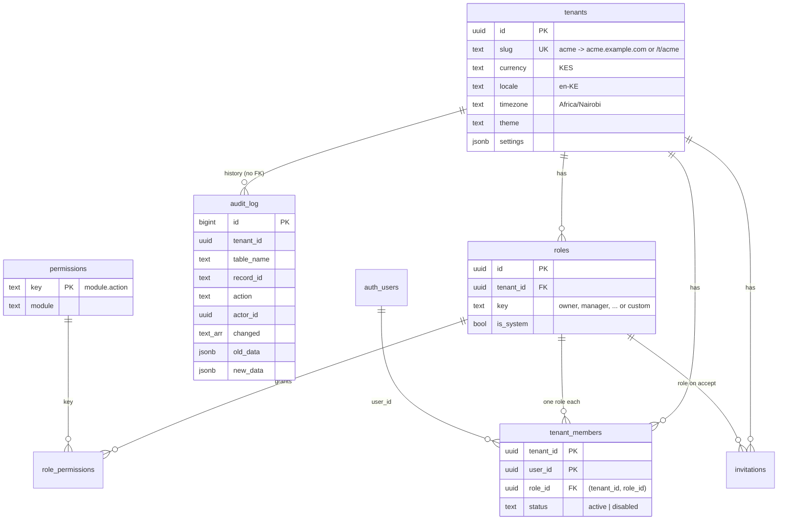
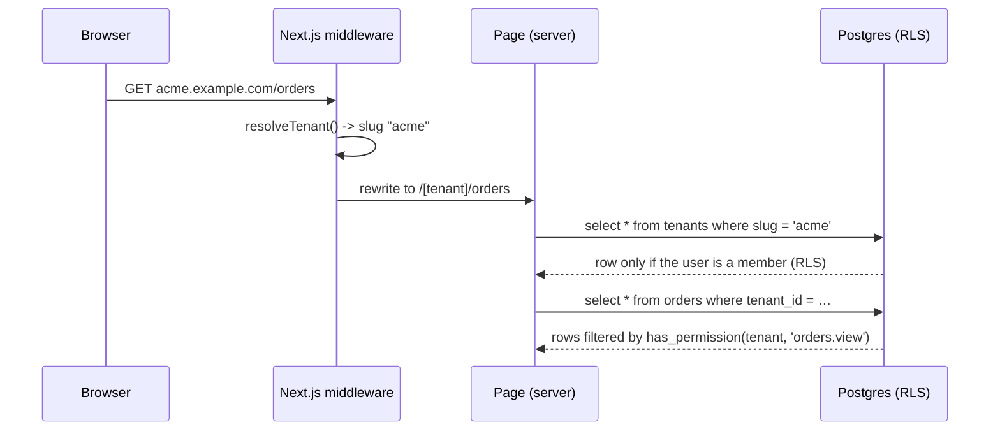
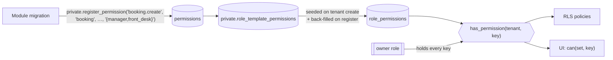
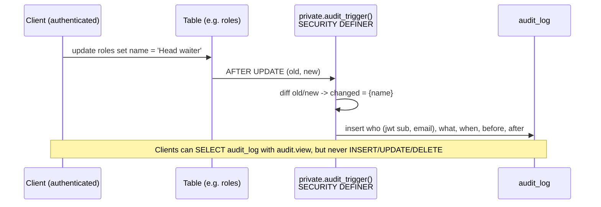

# Kitto architecture

This document explains how Kitto is put together. It grows with each module.

## Monorepo


- **pnpm workspaces + Turborepo.** Packages ship TypeScript source with no build step; Next.js compiles them through `transpilePackages`. Every package has `typecheck` and `test` tasks.
- **Each module owns its SQL.** `packages/<module>/supabase/migrations` and `.../tests` are the source of truth. `pnpm db:sync` copies them into the root `supabase/` folder, which is what the Supabase CLI reads. CI fails if the copy is stale (`pnpm db:sync:check`).
- **Ordered, append-only migrations.** Names are `YYYYMMDDHHMMSS_module_change.sql`. Each module owns a timestamp block so module order is fixed: core `20260101…`, customers `20260102…`, booking `20260103…`, billing `20260104…`, mpesa `20260105…`, inventory `20260106…`, orders `20260107…`, reports `20260108…`. Modules created with the generator use the current time, so they always sort later. Never edit a migration that has shipped; add a new one.

## Database core



### Multi-tenancy

Every tenant-owned table has a `tenant_id uuid not null` column, an index that starts with `tenant_id`, and RLS policies. Foreign keys that point at other tenant data are **composite** (`(tenant_id, role_id) -> roles(tenant_id, id)`), so a row can never reference another tenant's data, even through a bug in application code.

Policies use one shape everywhere:

```sql
using (tenant_id in (select private.permitted_tenant_ids('booking.view')))
```

The sub-select doesn't depend on the row, so Postgres evaluates it once per query instead of once per row (an "initPlan"), which keeps RLS fast on large tables.

### Which tenant is this request for?

The URL names the tenant, and the database decides whether the user may see it. `@kitto/core` ships `resolveTenant(config, host, pathname)` for both modes:

| Mode        | URL                         | Config                                   | Good for                          |
| ----------- | --------------------------- | ---------------------------------------- | --------------------------------- |
| `path`      | `example.com/t/acme/orders` | `NEXT_PUBLIC_TENANT_MODE=path`           | One domain, simplest DNS and auth |
| `subdomain` | `acme.example.com/orders`   | `…=subdomain`, `NEXT_PUBLIC_ROOT_DOMAIN` | Branded per-tenant addresses      |



Resolution only picks a tenant; it grants nothing. A user who edits the URL to another tenant's slug gets zero rows back, because every policy checks membership and permissions.

### Roles and permissions



- Permission keys are `module.action` (`booking.create`, `inventory.adjust`). Modules register their keys in their own migrations along with the default roles that receive them. Registering is idempotent and adds the key to existing tenants' system roles.
- Default roles: **owner, manager, front_desk, waiter, storekeeper, sales, viewer**. Tenants can create custom roles and choose their permissions.
- `public.has_permission(tenant_id, key)` is the single check used by RLS. The UI mirrors it with `can()` from `@kitto/core`, but only to hide buttons; the database enforces access.
- **No lock-out and no privilege escalation:**
  - The owner role implicitly holds every permission, and its permission list cannot be edited.
  - The last active owner cannot leave, be removed, disabled or demoted.
  - Only owners can grant the owner role.
  - A manager can only assign or invite roles whose permissions they already hold.
  - System roles cannot be deleted or have their key changed.

### Audit log



One generic trigger serves every table. Enable it with `select private.enable_audit('public.my_table');`. It skips updates that change nothing (or only `updated_at`).

### Security conventions

- `private` schema is not exposed through the API. Helpers live there.
- Every function sets `search_path = ''` and schema-qualifies names.
- Function `EXECUTE` is revoked from `public`/`anon`/`authenticated` and granted explicitly. Functions that anonymous users may call must have a comment starting with `[anon]`; a pgTAP test enforces this.
- Column-level grants limit what clients can change (e.g. a member can't edit `tenants.slug` or `roles.is_system`) on top of RLS.
- Schema guard tests check that every public table has RLS, every tenant table has a policy and a `tenant_id` index, and `anon` can read nothing.
