# Kitto architecture

This document explains how Kitto is put together. It grows with each module.

## Monorepo

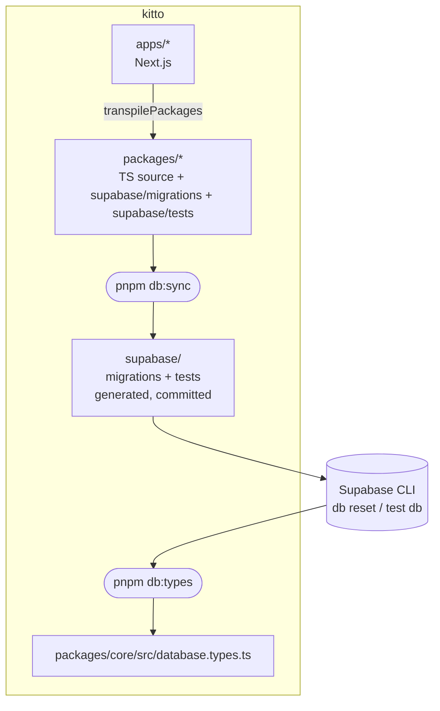

- **pnpm workspaces + Turborepo.** Packages ship TypeScript source with no build step; Next.js compiles them through `transpilePackages`. Every package has `typecheck` and `test` tasks.
- **Each module owns its SQL.** `packages/<module>/supabase/migrations` and `.../tests` are the source of truth. `pnpm db:sync` copies them into the root `supabase/` folder, which is what the Supabase CLI reads. CI fails if the copy is stale (`pnpm db:sync:check`).
- **Ordered, append-only migrations.** Names are `YYYYMMDDHHMMSS_module_change.sql`. Each module owns a timestamp block so module order is fixed: core `20260101…`, customers `20260102…`, booking `20260103…`, billing `20260104…`, mpesa `20260105…`, inventory `20260106…`, orders `20260107…`, reports `20260108…`. Modules created with the generator use the current time, so they always sort later. Never edit a migration that has shipped; add a new one.

## Database core

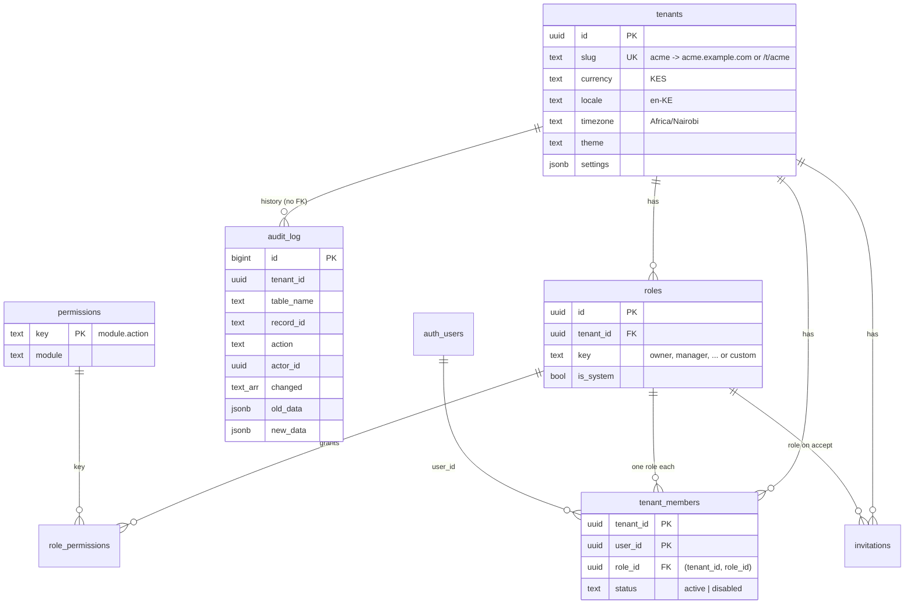

### Multi-tenancy

Every tenant-owned table has a `tenant_id uuid not null` column, an index that starts with `tenant_id`, and RLS policies. Foreign keys that point at other tenant data are **composite** (`(tenant_id, role_id) -> roles(tenant_id, id)`), so a row can never reference another tenant's data, even through a bug in application code.

Policies use one shape everywhere:

```sql
using (tenant_id in (select private.permitted_tenant_ids('booking.view')))
```

The sub-select doesn't depend on the row, so Postgres evaluates it once per query instead of once per row (an "initPlan"), which keeps RLS fast on large tables.

### Which tenant is this request for?

The URL names the tenant, and the database decides whether the user may see it. `@kitto/core` ships `resolveTenant(config, host, pathname)` for both modes:

| Mode        | URL                         | Config                                   | Good for                          |
| ----------- | --------------------------- | ---------------------------------------- | --------------------------------- |
| `path`      | `example.com/t/acme/orders` | `NEXT_PUBLIC_TENANT_MODE=path`           | One domain, simplest DNS and auth |
| `subdomain` | `acme.example.com/orders`   | `…=subdomain`, `NEXT_PUBLIC_ROOT_DOMAIN` | Branded per-tenant addresses      |

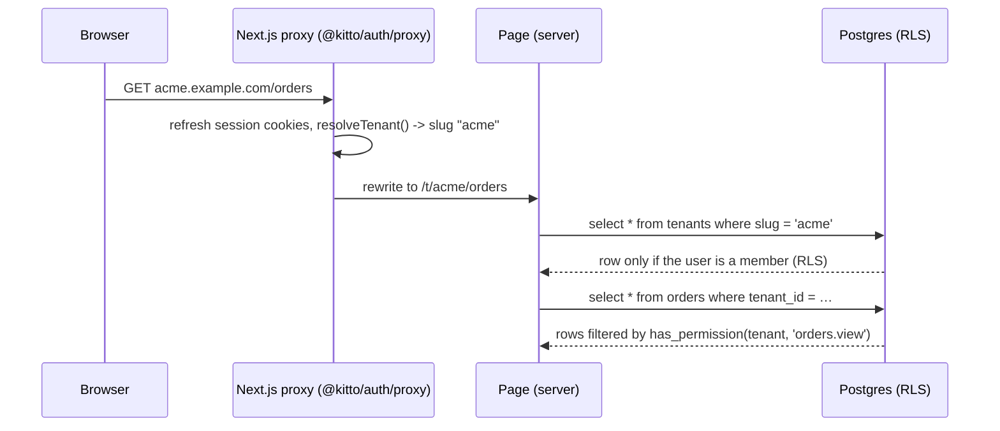

Resolution only picks a tenant; it grants nothing. A user who edits the URL to another tenant's slug gets zero rows back, because every policy checks membership and permissions. Both modes share one route tree (`app/t/[tenant]/…`): in subdomain mode the proxy rewrites `acme.example.com/x` to `/t/acme/x`, and links are built with `tenantHref()` so they work in either mode.

### Roles and permissions

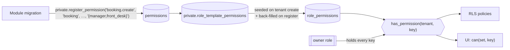

- Permission keys are `module.action` (`booking.create`, `inventory.adjust`). Modules register their keys in their own migrations along with the default roles that receive them. Registering is idempotent and adds the key to existing tenants' system roles.
- Default roles: **owner, manager, front_desk, waiter, storekeeper, sales, viewer**. Tenants can create custom roles and choose their permissions.
- `public.has_permission(tenant_id, key)` is the single check used by RLS. The UI mirrors it with `can()` from `@kitto/core`, but only to hide buttons; the database enforces access.
- **No lock-out and no privilege escalation:**
  - The owner role implicitly holds every permission, and its permission list cannot be edited.
  - The last active owner cannot leave, be removed, disabled or demoted.
  - Only owners can grant the owner role.
  - A manager can only assign or invite roles whose permissions they already hold.
  - System roles cannot be deleted or have their key changed.

### Audit log

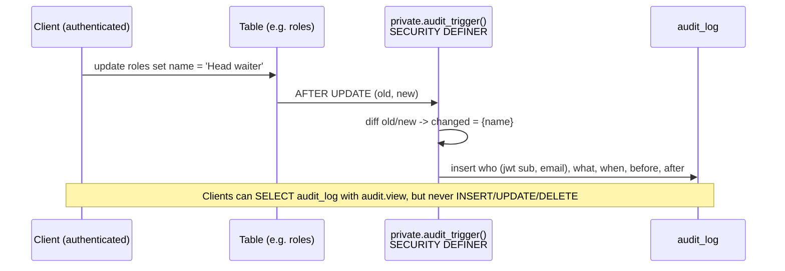

One generic trigger serves every table. Enable it with `select private.enable_audit('public.my_table');`. It skips updates that change nothing (or only `updated_at`).

### Security conventions

- `private` schema is not exposed through the API. Helpers live there.
- Every function sets `search_path = ''` and schema-qualifies names.
- Function `EXECUTE` is revoked from `public`/`anon`/`authenticated` and granted explicitly. Functions that anonymous users may call must have a comment starting with `[anon]`; a pgTAP test enforces this.
- Column-level grants limit what clients can change (e.g. a member can't edit `tenants.slug` or `roles.is_system`) on top of RLS.
- Schema guard tests check that every public table has RLS, every tenant table has a policy and a `tenant_id` index, and `anon` can read nothing.

## Sign-in and tenant switching (`@kitto/auth`)

Passwordless magic links, generalised from nextto. The email link carries a `token_hash` (not a PKCE code), so it works even when opened in a different browser or on a phone.

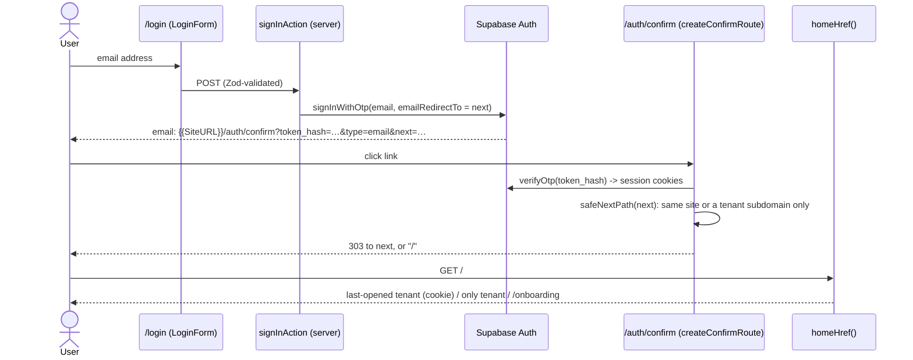

| Import               | What you get                                                                                                                           |
| -------------------- | -------------------------------------------------------------------------------------------------------------------------------------- |
| `@kitto/auth/proxy`  | `createKittoProxy()`: refreshes the session, rewrites subdomains, guards `/t/`, `/onboarding`, `/invite/`                              |
| `@kitto/auth/routes` | `createConfirmRoute()`, `createSignOutRoute()` for `app/auth/*/route.ts`                                                               |
| `@kitto/auth/server` | `getUser`, `requireUser`, `getTenantContext(slug)` (tenant, membership, permission set), `requirePermission`, `homeHref`, `tenantHref` |
| `@kitto/auth/client` | `LoginForm`, `OnboardingForm`, `AcceptInvitationForm`                                                                                  |
| `@kitto/auth`        | `TenantSwitcher`, `SignOutButton`, config and redirect helpers                                                                         |

`getTenantContext()` is wrapped in React `cache()`, so a layout and its page share one lookup per request. It calls `notFound()` when the user isn't an active member, so another tenant's URL looks exactly like a missing page. `requirePermission(ctx, 'members.manage')` does the same for pages a role may not open. Both are conveniences; RLS is still the real check.

**Invitations:** an admin calls `invite_member()` (SQL checks `members.manage` and that the inviter holds every permission of the role), then `sendInvitationEmail()` mails a magic link whose `next` is `/invite/<token>`. The invitee signs in and `accept_invitation()` adds the membership if the token is valid, unexpired and addressed to their email.

## UI kit (`@kitto/ui`)

- Tailwind v4 with CSS variables (`--color-brand`, `--color-surface`, …). Themes (`kitto`, `ocean`, `forest`, `sunset`, `plum`) are variable sets; `<ThemeStyle theme={tenant.theme}>` injects the tenant's palette, so each tenant can look different with no rebuild.
- Dark mode: `data-theme="light|dark"` on `<html>` from a cookie (no flash), `ThemeToggle` cycles system/light/dark.
- Server components by default (`DataTable`, `Card`, `Stat`, `Money`, `DateTime`, `Alert`, form fields). Interactive pieces live in `@kitto/ui/client` (`SubmitButton` with pending state, `ConfirmSubmit`, `ThemeToggle`, `NavLinks`).
- `Money` and `DateTime` format with the tenant's `currency`, `locale` and `time_zone`, so `KES 1,500.00` vs `$1,500.00` is a tenant setting.
- Accessibility is tested, not assumed: every page in the demo is swept with axe (WCAG 2.1 A/AA) at 360/768/1440 px in light and dark mode, and e2e tests fail if anything causes sideways scrolling on a phone.

## Admin portal (`@kitto/admin`)

Ready-made server-component pages that an app mounts with one-line route files:

```tsx
// app/t/[tenant]/admin/staff/page.tsx
export default async function Page({ params, searchParams }: PageProps<'/t/[tenant]/admin/staff'>) {
  return (
    <StaffPage
      ctx={await getTenantContext((await params).tenant)}
      searchParams={await searchParams}
    />
  );
}
```

| Page           | Permission       | What it does                                                             |
| -------------- | ---------------- | ------------------------------------------------------------------------ |
| `AdminHome`    | any admin key    | Section cards for what this role can manage                              |
| `StaffPage`    | `members.manage` | Members (change role, disable, remove), pending invitations, invite form |
| `RolesPage`    | `roles.manage`   | Custom roles and a permission matrix grouped by module                   |
| `SettingsPage` | `tenant.manage`  | Business name, currency, locale, time zone, theme                        |
| `AuditPage`    | `audit.view`     | Filterable audit log with before/after diffs, keyset-paginated           |

Every mutation follows the same pattern, which new modules copy:

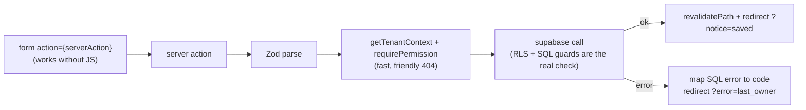

SQL raises descriptive errors (for example, "A workspace needs at least one active owner"), and the admin maps them to short codes and friendly messages. No database text is shown to users.

## Business modules

Each module is a package with the same shape, so a new one (or one made by the generator) is easy to find your way around:

```
packages/<module>/
  supabase/migrations/   ordered, append-only SQL (tables, RLS, audit, permissions)
  supabase/tests/        pgTAP
  src/permissions.ts     permission keys, mirrored from SQL
  src/schemas.ts         Zod schemas for every form
  src/data.ts            typed data access (takes a Supabase client)
  src/shared.ts          notice/error codes and nav entries
  src/actions.ts         'use server' actions (exported as ./actions)
  src/pages.tsx          server-component pages that apps mount
  src/*.test.ts          Vitest
```

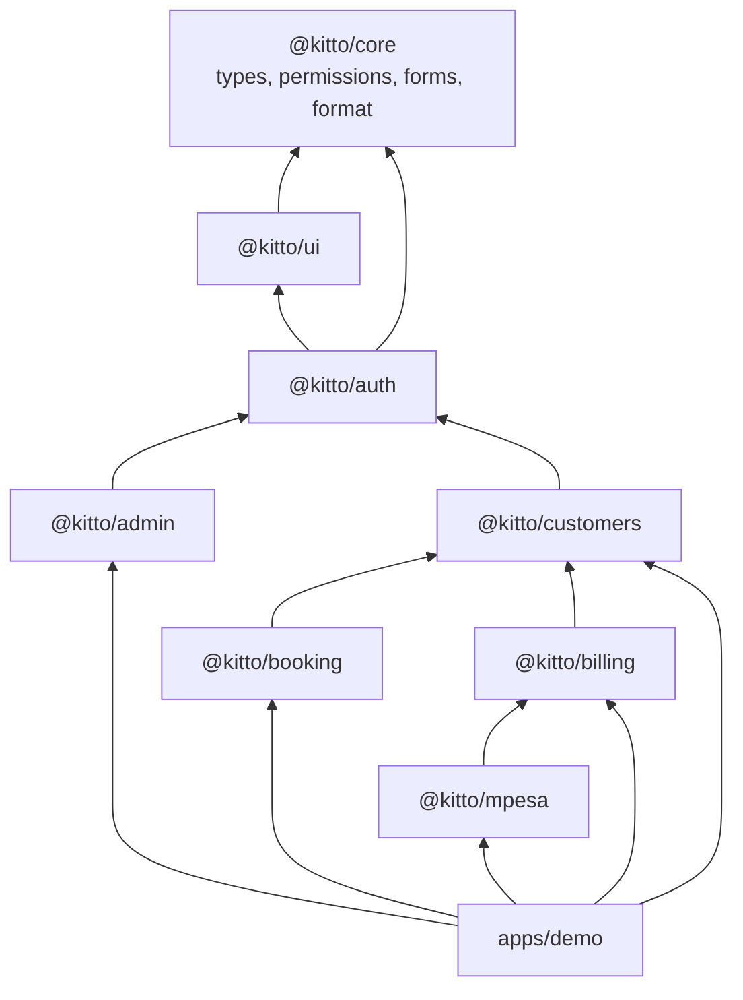

### Cross-module pages

Modules never import each other's pages in a cycle. Instead, a page accepts `sections`, and the app composes them. For example, the customer page shows that customer's reservations without `customers` depending on `booking`:

```tsx
// app/t/[tenant]/customers/[id]/page.tsx
<CustomerDetailPage
  ctx={ctx}
  id={id}
  searchParams={sp}
  sections={<CustomerReservations ctx={ctx} customerId={id} />}
/>
```

### Customers (`@kitto/customers`)

Customer records with contact details, tags (stored sorted and lower-case), notes, and an archive flag. People with history are archived, not deleted. Search matches name, email or phone digits. Permissions: `customers.view`, `customers.create`, `customers.edit`, `customers.delete` (only customers with no history).

### Booking (`@kitto/booking`)

Generic **resources** (a room, a table, a court, a test-drive car) with a capacity, a rate (`per booking | hour | day | night`) and optional weekly opening hours. **Reservations** belong to one resource and optionally one customer.

**No double-booking** is enforced by Postgres, not by application code:

```sql
constraint reservations_no_overlap exclude using gist (
  resource_id with =,
  during      with &&            -- tstzrange '[)': 10:00-11:00 and 11:00-12:00 don't clash
) where (private.reservation_blocks(status))   -- cancelled / no-show free the slot
```

Two people pressing "Book" at the same moment can't both win: the second insert fails with `23P01`, which the UI shows as "That time is already taken". Times are entered in the tenant's time zone and stored as UTC ranges.

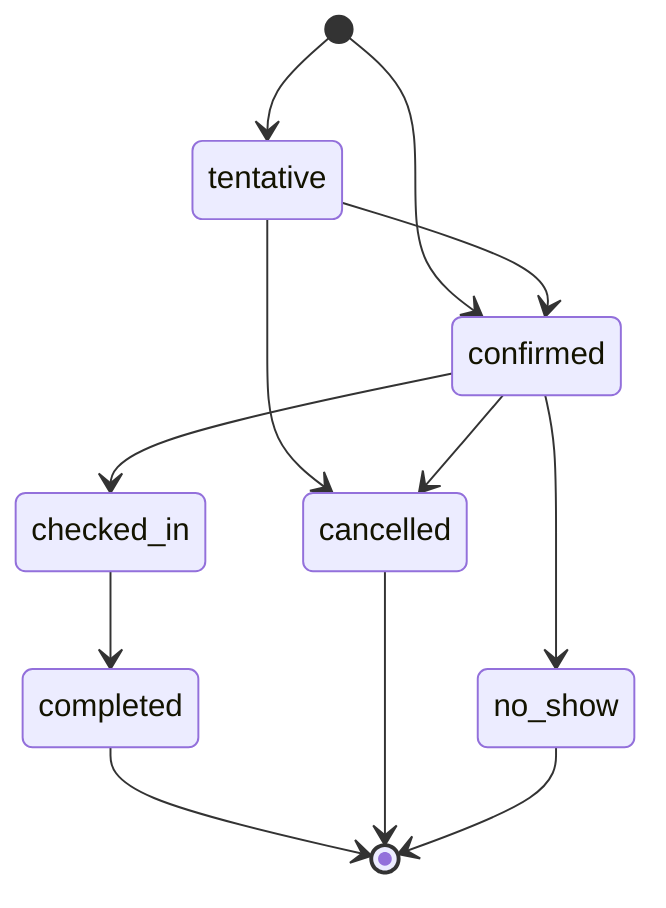

The status machine is enforced by a trigger; `STATUS_TRANSITIONS` in TypeScript only decides which buttons to show. Other SQL pieces:

| Function                                  | Technique                                                                                         |
| ----------------------------------------- | ------------------------------------------------------------------------------------------------- |
| `available_slots(resource, day, minutes)` | `generate_series` over opening hours, minus blocking reservations, ranges contained with `<@`     |
| `available_resources(kind, from, to)`     | anti-join on overlapping ranges                                                                   |
| `create_reservation(...)`                 | converts local time to UTC, checks capacity and active resource, price via trigger                |
| `create_recurring_reservations(...)`      | recursive CTE produces the occurrences; one insert, so a single clash rolls back the whole series |

Prices are stored as `price_minor` (integer cents) computed from the resource's rate when the reservation is made, so later rate changes don't rewrite history. Pages subscribe to Supabase Realtime (`LiveRefresh`) so the agenda updates when a colleague books.

### Billing (`@kitto/billing`)

Quotes and invoices share one `invoices` table (`kind = 'quote' | 'invoice'`) with `invoice_lines` and append-only `payments`. A document can point at a customer and, generically, at whatever it bills: `source_type` + `source_id` (for example `'reservation'` + the reservation's id, later an order). Billing never imports the module that owns the source, so booking (and later orders) don't depend on billing.

**Money** is integer minor units in the tenant's currency. Line subtotal, tax (basis points on top of the price, half-up per line) and total are Postgres `GENERATED` columns, and triggers keep the document totals in step. `math.ts` mirrors the same rounding only to preview totals while typing.

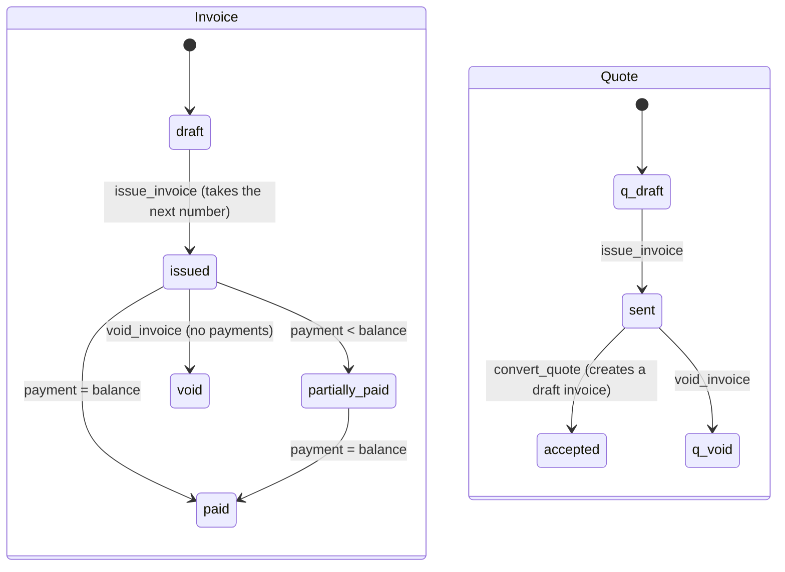

Status is **derived in SQL**: only `issue_invoice`, `void_invoice` and `convert_quote` (SECURITY DEFINER, each checking a permission) and the payment trigger change it. Issued documents are frozen; a wrong one is voided and its number stays used. A draft can be deleted.

**Payments** lock the invoice row (`SELECT … FOR UPDATE`) in a `BEFORE INSERT` trigger, refuse anything above the balance, then derive `partially_paid` / `paid` from `paid_minor`. Two people recording the last payment at the same moment can't overpay: the second waits for the lock and then sees the smaller balance. An M-Pesa receipt can settle only one payment per tenant (partial unique index).

**Gapless numbering.** `INV-00001`, `INV-00002`… and `QUO-00001`… per tenant. The number comes from a counter row in `private.billing_counters`, bumped by `INSERT … ON CONFLICT DO UPDATE` inside the issuing transaction:

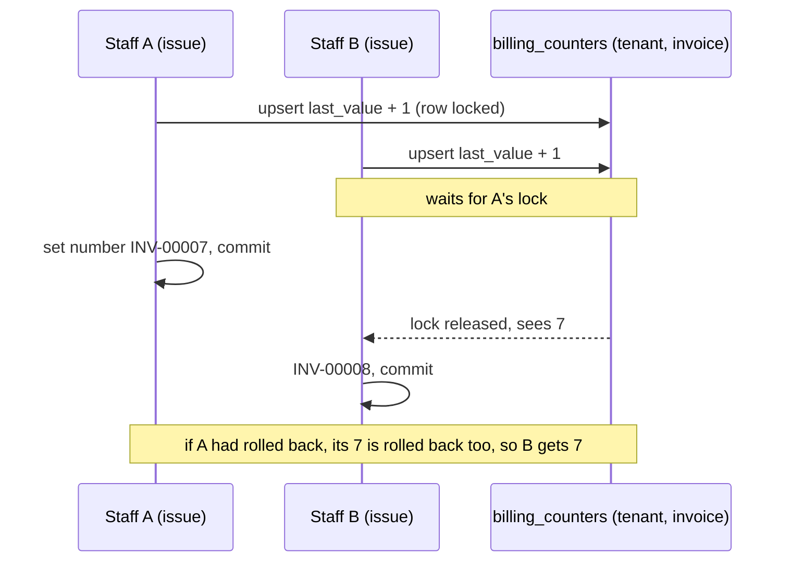

A sequence would be faster but leaves gaps on rollback, which tax authorities (e.g. KRA eTIMS) don't accept. Drafts have no number, so abandoned drafts never use one.

| Function                                         | What it does                                                                               |
| ------------------------------------------------ | ------------------------------------------------------------------------------------------ |
| `save_invoice_draft(...)`                        | creates or replaces a draft and its lines in one call (at most 100 lines)                  |
| `issue_invoice(id)`                              | numbers and dates the document (due date defaults to 14 days)                              |
| `void_invoice(id, reason)`                       | only issued documents without payments                                                     |
| `convert_quote(id)`                              | marks a sent quote accepted and copies it into a new draft invoice (`quote_id` links back) |
| `draft_invoice_for_source(type, id, lines, ...)` | the bridge other modules use: a draft invoice for a reservation, order…                    |

Pages: `InvoicesPage` (filter by type), `NewInvoicePage` (`?kind=quote`, `?customer=`), `EditInvoicePage`, `InvoiceDetailPage` (record payment, issue, convert, void; `sections`, `messages` and `sourceHref` props for other modules). Sections for other modules' pages: `CustomerInvoices` and `SourceInvoices` (the demo puts one on the reservation page with the reservation's price as the suggested line). PDFs are rendered with `@react-pdf/renderer` by `createInvoicePdfRoute()` (`@kitto/billing/pdf`), mounted at `app/t/[tenant]/invoices/[id]/pdf/route.ts`; it checks membership and `billing.view` like any page and returns `application/pdf` with `Cache-Control: private, no-store`.

Permissions: `billing.view`, `billing.create` (drafts), `billing.issue` (issue and convert), `billing.void`, `payments.record`.

### M-Pesa (`@kitto/mpesa`)

Collects invoice payments with Safaricom Daraja **STK push** (the customer gets a PIN prompt on their phone). `mpesa_requests` tracks each prompt; a successful callback records an ordinary `payments` row with `method = 'mpesa'` and the receipt as reference, so billing's overpayment and status rules apply unchanged.

```mermaid
sequenceDiagram
  actor Staff
  participant App as Next.js (requestMpesaAction)
  participant DB as Postgres
  participant D as Daraja
  participant Phone as Customer's phone
  Staff->>App: phone + amount
  App->>DB: mpesa_start_request(invoice, amount, phone, sha256(token))
  Note over DB: locks invoice, checks balance, one pending at a time, 5 per hour
  App->>D: OAuth token (cached), then STK push with CallBackURL /api/mpesa/callback/<token>
  D-->>App: CheckoutRequestID
  App->>DB: mpesa_attach_checkout
  D->>Phone: PIN prompt
  Phone-->>D: PIN / cancel / timeout
  D->>App: POST /api/mpesa/callback/<token>
  App->>DB: mpesa_record_callback(token, payload) (anon, SECURITY DEFINER)
  Note over DB: find by token hash, lock, idempotent; success -> payments insert -> invoice paid
  App-->>D: { ResultCode: 0 }
  DB-->>Staff: Realtime -> invoice page refreshes
  Note over App,D: MPESA_ENV=mock: no Daraja calls; after the response the app POSTs a<br/>Daraja-shaped callback to its own callback URL (numbers ending 1032 cancel, 0001 fail)
```

- **Callback authentication.** Each request gets a fresh random token in its callback path; only its SHA-256 hash is stored. Guessing a path is as hard as guessing the token, there is no shared secret to leak or rotate, and a leaked URL only affects one request. The callback route is excluded from the proxy (no session) and calls one function that anonymous callers may execute.
- **Idempotent.** A request that is already settled returns `duplicate` and changes nothing, so Safaricom's retries are harmless. A receipt can't be applied twice (unique index on `payments`).
- **Money is never dropped.** If the customer paid but the payment can't be applied (the invoice was voided or paid meanwhile, or the amount differs), the request becomes `needs_review` for a person to refund or apply by hand.
- **Mock mode** (`MPESA_ENV=mock`) is used locally and in CI: same code path and SQL, only the HTTP call to Safaricom is replaced, and the callback really travels through the route.
- **Credentials** are app-level env vars (one paybill/till for the deployment). Per-tenant shortcodes would add an encrypted credentials table and a settings page; the client already takes its config as an argument for that. `stkQuery` (status lookup) is in the client but not yet wired up: requests left pending more than 5 minutes are marked `expired` when the next one starts, and a late callback can still settle an expired request.

Permission: `mpesa.request` (viewing requests needs `billing.view`). The demo composes `InvoiceMpesa` into `InvoiceDetailPage`'s `sections` and mounts `createMpesaCallbackRoute()` at `app/api/mpesa/callback/[secret]/route.ts`.
