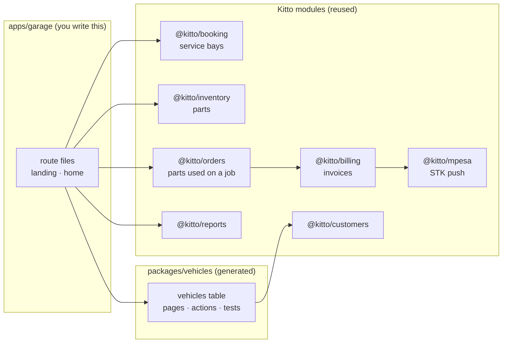
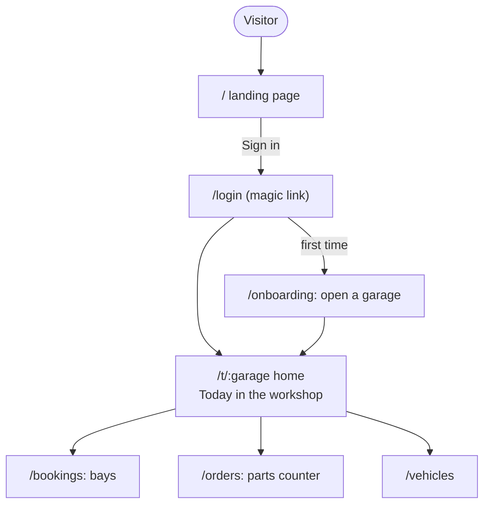
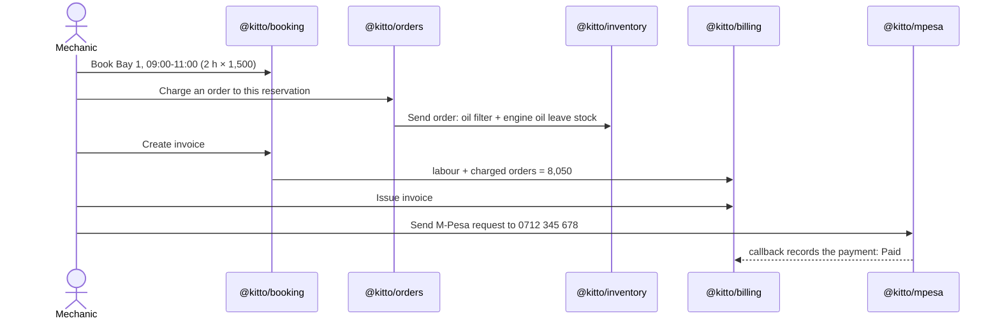
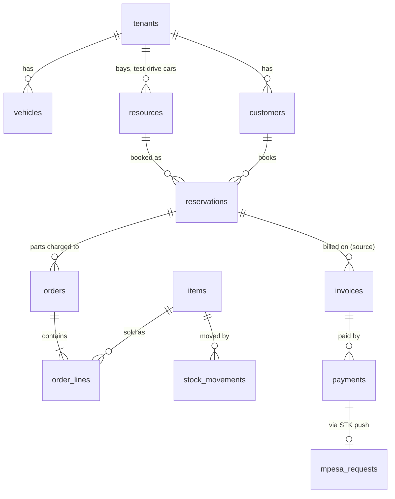

# Tutorial: build an app in an hour

In this tutorial you build **Kitto Garage**, a small app for a car workshop. Customers bring their cars in for a service. You book the job into a service bay, charge the parts used, invoice labour and parts together, and the customer pays by M-Pesa.

You write very little code. Most of the app comes from the Kitto modules: you copy the demo app, generate one new module (`vehicles`), add a rule and its test, and write two pages.



Everything below was done for real on a clean checkout, and the snippets are copied from the working result. The commands are PowerShell; there is a bash version of each command where it differs.

| Time      | Step                                                                  |
| --------- | --------------------------------------------------------------------- |
| 0:00-0:10 | [Get the demo running](#000-010-get-the-demo-running)                 |
| 0:10-0:15 | [Copy the demo into a new app](#010-015-copy-the-demo-into-a-new-app) |
| 0:15-0:25 | [Generate the vehicles module](#015-025-generate-the-vehicles-module) |
| 0:25-0:35 | [Add a rule, with a test](#025-035-add-a-rule-with-a-test)            |
| 0:35-0:45 | [Make it a garage](#035-045-make-it-a-garage)                         |
| 0:45-0:55 | [A day in the workshop](#045-055-a-day-in-the-workshop)               |
| 0:55-1:00 | [Test it like CI does](#055-100-test-it-like-ci-does)                 |
|           | [Next steps: a hotel, a dealership](#next-steps-a-hotel-a-dealership) |

## 0:00-0:10 Get the demo running

Follow [Local development in SETUP.md](SETUP.md#1-local-development). In short:

```powershell
pnpm install
pnpm db:start           # Supabase in Docker: API 55321, DB 55322, Mailpit 55324
Copy-Item apps\demo\.env.example apps\demo\.env.local   # paste both keys from db:start
pnpm dev
```

Open <http://localhost:3000>, sign in with any email address and pick up the magic link from Mailpit at <http://localhost:55324>. Create a workspace, then press **Load sample data** to look around a working hotel. Stop `pnpm dev` when you are done.

## 0:10-0:15 Copy the demo into a new app

The demo already mounts every module, so it is the quickest place to start. Copy it without build output:

```powershell
robocopy apps\demo apps\garage /E /XD node_modules .next .turbo test-results playwright-report /XF .env.local next-env.d.ts tsconfig.tsbuildinfo
Copy-Item apps\demo\.env.local apps\garage\.env.local
```

```bash
rsync -a apps/demo/ apps/garage/ --exclude node_modules --exclude .next --exclude .turbo \
  --exclude test-results --exclude playwright-report --exclude next-env.d.ts --exclude tsconfig.tsbuildinfo
cp apps/demo/.env.local apps/garage/.env.local
```

`robocopy` exits with code 1 when it copied files. That is success.

Remove the demo-only parts: its README, the sample data, and its end-to-end tests (keep `e2e/helpers.ts`).

```powershell
Remove-Item apps\garage\README.md, apps\garage\src\lib -Recurse
Remove-Item -LiteralPath 'apps\garage\src\app\t\[tenant]\actions.ts'
Get-ChildItem apps\garage\e2e\*.spec.ts | Remove-Item
```

Use `-LiteralPath` for paths with `[tenant]` in them: PowerShell reads square brackets as a wildcard otherwise.

In `apps/garage/package.json`, change the name and description:

```json
  "name": "@kitto/garage",
  "description": "Kitto Garage: workshop bookings, parts and invoices.",
```

## 0:15-0:25 Generate the vehicles module

A garage needs to know about cars. No Kitto module has them, so generate one:

```powershell
pnpm create-kitto-module vehicles --fields "reg:text! make:text! model:text! year:int price:money notes:longtext" --app apps/garage --apply
```

- `!` marks a required field. The first required text field (`reg`) names each record in lists and headings.
- `--app apps/garage` also writes route files and an end-to-end test into the app, and adds the module to its `package.json`, `next.config.ts` and nav.
- `--apply` then runs `pnpm install`, `pnpm db:sync`, `pnpm db:reset` and `pnpm db:types` for you.
- Try `--dry-run` first to see the list of files without writing anything.

You now have a complete module:

```text
packages/vehicles/
  supabase/migrations/<timestamp>_vehicles.sql   table, RLS, permissions, audit, grants
  supabase/tests/vehicles_test.sql               pgTAP: RLS and permissions
  src/permissions.ts  schemas.ts  data.ts  actions.ts  shared.ts  pages.tsx  index.ts
  src/vehicles.test.ts                           Vitest: form parsing
apps/garage/
  src/app/t/[tenant]/vehicles/page.tsx           list
  src/app/t/[tenant]/vehicles/new/page.tsx       add
  src/app/t/[tenant]/vehicles/[id]/page.tsx      view and edit
  e2e/vehicles.spec.ts
```

The route files are tiny. Each one resolves the tenant and renders a page exported by the module:

```tsx
// apps/garage/src/app/t/[tenant]/vehicles/page.tsx
import type { Metadata } from 'next';
import { getTenantContext } from '@kitto/auth/server';
import { VehiclesPage } from '@kitto/vehicles';

export const metadata: Metadata = { title: 'Vehicles' };

export default async function Page({ params, searchParams }: PageProps<'/t/[tenant]/vehicles'>) {
  return (
    <VehiclesPage
      ctx={await getTenantContext((await params).tenant)}
      searchParams={await searchParams}
    />
  );
}
```

The migration registers four permissions, `vehicles.view`, `vehicles.create`, `vehicles.edit` and `vehicles.delete`, and gives them to the built-in roles. Owners can change that in **Admin → Roles**. The nav entry only shows to people with `vehicles.view`:

```tsx
// apps/garage/src/app/t/[tenant]/layout.tsx (added by the generator)
const nav: NavItem[] = [
  { href: ctx.path('/'), label: 'Home', exact: true },
  ...bookingNav(ctx),
  ...ordersNav(ctx),
  ...inventoryNav(ctx),
  ...customersNav(ctx),
  ...billingNav(ctx),
  ...reportsNav(ctx),
  ...vehiclesNav(ctx),
];
```

Run `pnpm --filter @kitto/garage dev`, open your workspace and add a car. It already validates input, is private to the workspace, writes to the audit log, and works without JavaScript.

## 0:25-0:35 Add a rule, with a test

A workshop should not have the same car on file twice. "KDA 123A" and "kda 123a" are the same registration, so the rule is a unique index on `lower(reg)`.

Never edit a migration that has already run somewhere. Add a second one next to the generated migration, with a later timestamp:

```sql
-- packages/vehicles/supabase/migrations/20261027210000_vehicles_unique_reg.sql
-- =============================================================================
-- vehicles 0002 One registration number per workshop.
--
-- "KDA 123A" and "kda 123a" are the same car, so the unique index is on
-- lower(reg). It replaces the generator's plain search index on the same key.
-- =============================================================================

drop index public.vehicles_tenant_reg_idx;
create unique index vehicles_tenant_reg_key on public.vehicles (tenant_id, lower(reg));
```

Use any timestamp later than the generated one. CI checks the file name matches `YYYYMMDDHHMMSS_name.sql`.

Prove the rule with a pgTAP test. It also proves the rule is per workshop: another garage may service the same car.

```sql
-- packages/vehicles/supabase/tests/vehicles_reg_test.sql
-- Vehicles: one registration number per workshop.
begin;
create extension if not exists pgtap with schema extensions;
select plan(3);

-- A signed-in user who owns two workshops.
insert into auth.users (instance_id, id, aud, role, email)
values ('00000000-0000-0000-0000-000000000000', 'c7000000-0000-0000-0000-000000000001',
        'authenticated', 'authenticated', 'owner@garage.test');
select set_config('request.jwt.claims', json_build_object(
  'sub', 'c7000000-0000-0000-0000-000000000001', 'role', 'authenticated',
  'email', 'owner@garage.test')::text, true);
select public.create_tenant('Garage A', 'garage-a');
select public.create_tenant('Garage B', 'garage-b');

prepare add_car(text, text) as
  insert into public.vehicles (tenant_id, reg, make, model)
  select id, $2, 'Toyota', 'Probox' from public.tenants where slug = $1;

select lives_ok($$execute add_car('garage-a', 'KDA 123A')$$, 'a workshop adds a car');
select throws_ok(
  $$execute add_car('garage-a', 'kda 123a')$$, '23505', null,
  'the same registration twice in one workshop is refused'
);
select lives_ok($$execute add_car('garage-b', 'KDA 123A')$$, 'another workshop may have it');

select * from finish();
rollback;
```

Copy the package's SQL into `supabase/`, rebuild the local database and run every database test:

```powershell
pnpm db:sync     # copies packages/*/supabase/** into supabase/
pnpm db:reset    # replays all migrations
pnpm db:test     # pgTAP, every module
```

Finally, give the error a friendly message. A unique violation (SQL state `23505`) reaches the form as `?error=exists`, which shows "That already exists." by default. Override it in the module's own messages:

```ts
// packages/vehicles/src/shared.ts
/** ?error= codes on top of COMMON_ERRORS. */
export const VEHICLE_ERRORS = {
  invalid_reg: 'Enter a reg of up to 200 characters.',
  // ...
  invalid_notes: 'Keep the notes under 2,000 characters.',
  exists: 'A vehicle with that registration is already on file.',
} as const;
```

The index changed but no columns did, so `pnpm db:types` has nothing new to write. Run it whenever a migration adds or changes columns or functions.

## 0:35-0:45 Make it a garage

Two pages turn the demo into a garage: the public landing page and the workspace home.



Replace `apps/garage/src/app/page.tsx`:

```tsx
import Link from 'next/link';
import { redirect } from 'next/navigation';
import { homeHref } from '@kitto/auth/server';
import { buttonClass } from '@kitto/ui';

export default async function Home() {
  const href = await homeHref();
  if (href) redirect(href);
  return (
    <main id="main" className="mx-auto flex min-h-dvh max-w-2xl flex-col justify-center px-4 py-10">
      <p className="text-sm font-semibold tracking-wide text-brand uppercase">Kitto Garage</p>
      <h1 className="mt-2 text-3xl font-bold text-balance">Run your workshop from your phone</h1>
      <p className="mt-3 max-w-prose text-muted">
        Book service bays and test drives, sell parts over the counter, and send invoices that
        customers pay with M-Pesa.
      </p>
      <div className="mt-6 flex flex-wrap gap-3">
        <Link href="/login" className={buttonClass()}>
          Sign in
        </Link>
        <Link href="/login?next=/onboarding" className={buttonClass('secondary')}>
          Open a garage
        </Link>
      </div>
    </main>
  );
}
```

`homeHref()` sends people who are already signed in straight to their workspace.

Replace `apps/garage/src/app/t/[tenant]/page.tsx` with a home page that lists today's jobs. It uses the booking module's data function, so row-level security and the time zone rules are the same as everywhere else:

```tsx
import Link from 'next/link';
import { getTenantContext } from '@kitto/auth/server';
import { BOOKING_PERMISSIONS, listReservations } from '@kitto/booking';
import { addDays, formatDate, todayIn, zonedTimeToUtc } from '@kitto/core';
import { LowStockCard } from '@kitto/inventory';
import { ORDER_PERMISSIONS } from '@kitto/orders';
import { ReportsKpiCard } from '@kitto/reports';
import { Card, EmptyState, PageHeader, buttonClass } from '@kitto/ui';
import { VEHICLE_PERMISSIONS } from '@kitto/vehicles';

export default async function GarageHome({ params }: PageProps<'/t/[tenant]'>) {
  const ctx = await getTenantContext((await params).tenant);
  const { timezone } = ctx.tenant;

  // Today's jobs: reservations overlapping today in the garage's time zone.
  const today = todayIn(timezone);
  const jobs = ctx.can(BOOKING_PERMISSIONS.view)
    ? await listReservations(ctx.db, ctx.tenant.id, {
        from: zonedTimeToUtc(`${today}T00:00`, timezone).toISOString(),
        to: zonedTimeToUtc(`${addDays(today, 1)}T00:00`, timezone).toISOString(),
        statuses: ['tentative', 'confirmed', 'checked_in'],
      })
    : [];
  // starts_at/ends_at are generated from the booked period, so typed as nullable.
  const time = (iso: string | null) =>
    iso ? formatDate(iso, ctx.tenant, { hour: '2-digit', minute: '2-digit', hour12: false }) : '';

  const actions = [
    [BOOKING_PERMISSIONS.create, '/bookings/new', 'Book a job'],
    [ORDER_PERMISSIONS.create, '/orders/new', 'Parts counter sale'],
    [VEHICLE_PERMISSIONS.create, '/vehicles/new', 'Add a vehicle'],
  ].filter(([permission]) => ctx.can(permission!));

  return (
    <>
      <PageHeader
        eyebrow={formatDate(new Date(), ctx.tenant, { dateStyle: 'full' })}
        title={ctx.tenant.name}
        actions={actions.map(([, path, label]) => (
          <Link key={path} href={ctx.path(path)} className={buttonClass('secondary')}>
            {label}
          </Link>
        ))}
      />
      {ctx.can(BOOKING_PERMISSIONS.view) && (
        <Card aria-labelledby="jobs-heading" className="mb-6">
          <h2 id="jobs-heading" className="mb-3 font-semibold">
            Today in the workshop
          </h2>
          {jobs.length === 0 ? (
            <EmptyState title="No jobs booked today" />
          ) : (
            <ul className="divide-y divide-line">
              {jobs.map((j) => (
                <li key={j.id} className="flex flex-wrap justify-between gap-2 py-2">
                  <Link href={ctx.path(`/bookings/${j.id}`)} className="font-medium text-brand">
                    {j.resource?.name}
                    {j.title ? ` · ${j.title}` : ''}
                  </Link>
                  <span className="text-muted tabular-nums">
                    {time(j.starts_at)}–{time(j.ends_at)} · {j.customer?.name ?? 'Walk-in'}
                  </span>
                </li>
              ))}
            </ul>
          )}
        </Card>
      )}
      <div className="grid gap-6 lg:grid-cols-2">
        <ReportsKpiCard ctx={ctx} />
        <LowStockCard ctx={ctx} />
      </div>
    </>
  );
}
```

Things to notice:

- Every link and card checks a permission with `ctx.can`. A storekeeper sees stock, not bookings.
- `ctx.path('/bookings')` builds the right URL for both [tenant modes](ARCHITECTURE.md#which-tenant-is-this-request-for): `/t/my-garage/bookings` or `my-garage.example.com/bookings`.
- `ReportsKpiCard` and `LowStockCard` are ready-made cards exported by modules. They check their own permissions and render nothing for people who may not see them.
- There is no client JavaScript on this page: it is a server component.

## 0:45-0:55 A day in the workshop

Run `pnpm --filter @kitto/garage dev`, open a new garage and set it up through the UI. No more code.



1. **Customer and car.** Customers → New: Juma Mwangi. Vehicles → New vehicle: Reg KDA 123A, Toyota Probox, 2016. Try adding "kda 123a" again to see your rule.
2. **A service bay.** Bookings → Resources: Name **Bay 1**, Kind **service bay**, Rate **1500**, Charged **per hour**, then **Add resource**. Kind is free text, so a hotel's "room" and a garage's "service bay" or "test drive car" are all resources. Add opening hours on the resource page if you want the slot picker to show free times.
3. **Parts.** Inventory → Items → New: **Oil filter**, price 850, reorder level 2, then **Adjust stock**: Location Main store, Change 10, Reason Opening count. Do the same for **Engine oil 5L** at 4200 with 3 in stock. A real garage would use **New purchase** → **Receive into stock** with a supplier.
4. **Book the job.** Bookings → New: Bay 1, 09:00 to 11:00, customer Juma Mwangi, title "Full service KDA 123A", **Book**. Double-booking the bay is impossible: the database refuses overlapping times.
5. **Parts used on the job.** On the booking, **Charge an order to this reservation**. Label it "Parts", add one oil filter and one engine oil, then **Send order**. Sending takes the parts out of stock.
6. **Invoice.** Back on the booking, **Create invoice**. One invoice holds the labour (2 hours × 1,500) and the charged parts (850 + 4,200): **KES 8,050.00**. **Issue invoice** gives it the next gapless number.
7. **Payment.** Enter the customer's M-Pesa number, 0712 345 678, and **Send M-Pesa request**. Locally the mock provider "pays" within a few seconds and the invoice turns **Paid** without a reload (Supabase Realtime). With the mock, numbers ending 1032 cancel and 0001 fail. To use the Daraja sandbox see [SETUP.md](SETUP.md#4-m-pesa-daraja).
8. **Reorder.** Engine oil is down to 2, its reorder level, so it shows under Inventory → Low stock and on the home page. Reports shows the day's takings.

Then invite your mechanic from **Admin → Staff**, and in **Admin → Roles** create a "Mechanic" role with bookings, orders and vehicles permissions.

## 0:55-1:00 Test it like CI does

Write the day above as a Playwright test, `apps/garage/e2e/workshop.spec.ts`. It reuses the demo's `createWorkspace` helper (sign in through Mailpit, create a workspace) and checks accessibility with axe:

```ts
import AxeBuilder from '@axe-core/playwright';
import { expect, test, type Page } from '@playwright/test';
import { createWorkspace, uniqueEmail, uniqueSlug } from './helpers';

async function addPart(page: Page, home: string, name: string, price: string, count: string) {
  await page.goto(`${home}/inventory/items/new`);
  await page.getByLabel('Name').fill(name);
  await page.getByLabel('Price (KES)').fill(price);
  await page.getByLabel('Reorder level').fill('2');
  await page.getByRole('button', { name: 'Add item' }).click();
  await page.getByRole('link', { name: 'Adjust stock' }).click();
  await page.getByLabel('Location').selectOption({ label: 'Main store' });
  await page.getByLabel('Change').fill(count);
  await page.getByLabel('Reason').fill('Opening count');
  await page.getByRole('button', { name: 'Adjust stock' }).click();
  await expect(page.getByText('Stock adjusted.')).toBeVisible();
}

test('a day at Kitto Garage', async ({ page }) => {
  test.setTimeout(180_000);
  const home = await createWorkspace(
    page,
    uniqueEmail('mechanic'),
    'Kitto Garage',
    uniqueSlug('kg'),
  );
  await expect(page.getByRole('heading', { name: 'Today in the workshop' })).toBeVisible();
  const axe = await new AxeBuilder({ page }).withTags(['wcag2a', 'wcag2aa']).analyze();
  expect(axe.violations).toEqual([]);

  // A customer and their car.
  await page.goto(`${home}/customers/new`);
  await page.getByLabel('Name').fill('Juma Mwangi');
  await page.getByRole('button', { name: 'Add customer' }).click();
  await expect(page.getByText('Customer added.')).toBeVisible();
  await page.goto(`${home}/vehicles/new`);
  await page.getByLabel('Reg', { exact: true }).fill('KDA 123A');
  await page.getByLabel('Make', { exact: true }).fill('Toyota');
  await page.getByLabel('Model', { exact: true }).fill('Probox');
  await page.getByLabel('Year', { exact: true }).fill('2016');
  await page.getByRole('button', { name: 'Add vehicle' }).click();
  await expect(page.getByText('Vehicle added.')).toBeVisible();
  // The unique index from the second migration.
  await page.goto(`${home}/vehicles/new`);
  await page.getByLabel('Reg', { exact: true }).fill('kda 123a');
  await page.getByLabel('Make', { exact: true }).fill('Toyota');
  await page.getByLabel('Model', { exact: true }).fill('Probox');
  await page.getByRole('button', { name: 'Add vehicle' }).click();
  await expect(
    page.getByText('A vehicle with that registration is already on file.'),
  ).toBeVisible();

  // A service bay, charged by the hour.
  await page.goto(`${home}/bookings/resources`);
  await page.getByLabel('Name').fill('Bay 1');
  await page.getByLabel('Kind').fill('service bay');
  await page.getByLabel(/^Rate/).fill('1500');
  await page.getByLabel('Charged').selectOption({ label: 'per hour' });
  await page.getByRole('button', { name: 'Add resource' }).click();
  await expect(page.getByRole('heading', { level: 1, name: 'Bay 1' })).toBeVisible();
  const bay = page.url().split('?')[0]!.split('/').pop()!;

  // Parts.
  await addPart(page, home, 'Oil filter', '850', '10');
  await addPart(page, home, 'Engine oil 5L', '4200', '3');

  // Book a two-hour service.
  await page.goto(`${home}/bookings/new?resource=${bay}&day=2030-03-04`);
  await page.getByLabel('Starts').fill('2030-03-04T09:00');
  await page.getByLabel('Ends').fill('2030-03-04T11:00');
  await page.getByLabel('Customer').selectOption({ label: 'Juma Mwangi' });
  await page.getByLabel('Title').fill('Full service KDA 123A');
  await page.getByRole('button', { name: 'Book', exact: true }).click();
  await expect(
    page.getByRole('heading', { level: 1, name: 'Bay 1 · Full service KDA 123A' }),
  ).toBeVisible();
  const job = page
    .url()
    .replace(/^https?:\/\/[^/]+/, '')
    .split('?')[0]!;

  // Parts used on the job, charged to it.
  await page.getByRole('link', { name: 'Charge an order to this reservation' }).click();
  await page.getByLabel('Table or label').fill('Parts');
  await page.getByRole('button', { name: 'Open order' }).click();
  await page.getByLabel('Item', { exact: true }).selectOption({ label: 'Oil filter (each)' });
  await page.getByLabel('Quantity').fill('1');
  await page.getByRole('button', { name: 'Add line' }).click();
  await expect(page.getByText('Line added.')).toBeVisible();
  await page.getByLabel('Item', { exact: true }).selectOption({ label: 'Engine oil 5L (each)' });
  await page.getByLabel('Quantity').fill('1');
  await page.getByRole('button', { name: 'Add line' }).click();
  await expect(page.getByText('Line added.')).toBeVisible();
  await page.getByRole('button', { name: 'Send order' }).click();
  await expect(page.getByText('Order sent.', { exact: false })).toBeVisible();

  // One invoice for labour and parts, paid by M-Pesa (mock).
  await page.goto(job);
  await page.getByRole('button', { name: 'Create invoice' }).click();
  await expect(page.getByTestId('invoice-total')).toContainText('8,050.00');
  await page.getByRole('button', { name: 'Issue invoice' }).click();
  await page.getByLabel("Customer's M-Pesa number").fill('0712 345 678');
  await page.getByRole('button', { name: 'Send M-Pesa request' }).click();
  await expect(async () => {
    await page.reload();
    await expect(page.getByRole('heading', { level: 1 })).toContainText('Paid', {
      timeout: 1_000,
    });
  }).toPass({ timeout: 20_000 });

  // Engine oil is now at its reorder level.
  await page.goto(`${home}/inventory/low`);
  await expect(page.getByRole('link', { name: /Engine oil 5L/ })).toBeVisible();
  await page.goto(`${home}/reports?from=2030-03-01&to=2030-03-31`);
  await expect(page.getByRole('heading', { level: 1, name: 'Reports' })).toBeVisible();
});
```

Run every check, the same ones CI runs:

```powershell
pnpm format; pnpm lint; pnpm typecheck; pnpm test     # Prettier, ESLint, tsc, Vitest
pnpm db:test; pnpm db:lint; pnpm db:types:check       # pgTAP, plpgsql_check, generated types
pnpm --filter @kitto/garage build
cd apps\garage
$env:CI = '1'; pnpm exec playwright test              # vehicles.spec + workshop.spec, mobile and desktop
```

```bash
cd apps/garage && CI=1 pnpm exec playwright test
```

`CI=1` makes Playwright serve the production build instead of `next dev`. Both projects run: a Pixel 7 phone and a desktop browser.

That is the hour. To ship it, follow [SETUP.md](SETUP.md): create a Supabase project, `supabase db push`, and deploy `apps/garage` to Vercel as its own project.

## What you got for free

| You wrote                         | Kitto gave you                                                                                                   |
| --------------------------------- | ---------------------------------------------------------------------------------------------------------------- |
| One generator command             | A vehicles table with RLS, permissions, audit log, column grants, pages, actions and tests                       |
| One index, one 20-line pgTAP test | Case-insensitive, per-workshop unique registrations, proven in the database                                      |
| Two pages                         | Sign in by magic link, workspaces, staff invitations, roles, themes and dark mode, KES formatting                |
| Nothing                           | Double-booking prevention, gapless invoice numbers, no negative stock, M-Pesa with idempotent callbacks, reports |

The [LEARNING.md](../LEARNING.md) guide explains how those rules work.

## Next steps: a hotel, a dealership

The modules are generic on purpose. Here is how two more apps map onto them.

### A hotel

The demo's sample data is already a small hotel.

| Hotel feature              | Kitto                                                                                                 |
| -------------------------- | ----------------------------------------------------------------------------------------------------- |
| Rooms                      | `@kitto/booking` resources with kind `room`, charged `per night`, capacity = beds                     |
| Stays, check-in, check-out | Reservations. Status moves tentative → confirmed → checked in → completed; overlaps are refused       |
| Conference rooms           | Resources charged `per hour`, with opening hours and repeating bookings for weekly meetings           |
| Restaurant and bar         | `@kitto/orders` with the `waiter` role. Charge an order to a reservation to put it on the room bill   |
| Minibar and kitchen stock  | `@kitto/inventory` items, suppliers, purchases and low-stock alerts. Sending an order takes stock out |
| Folio at check-out         | **Create invoice** on the reservation: nights plus every charged order, on one invoice                |
| Deposits and M-Pesa        | `@kitto/billing` part payments, `@kitto/mpesa` STK push                                               |
| Guests                     | `@kitto/customers`, with tags such as `vip`                                                           |
| Front desk, waiters, store | Built-in roles `front_desk`, `waiter`, `storekeeper`; add a "Housekeeping" role in Admin → Roles      |
| Occupancy and takings      | `@kitto/reports`: utilisation per room, revenue, payment methods, receivables                         |
| Housekeeping tasks (new)   | `pnpm create-kitto-module housekeeping --fields "room:text! task:text! done:bool notes:longtext"`     |

### A car dealership

| Dealership feature    | Kitto                                                                                                    |
| --------------------- | -------------------------------------------------------------------------------------------------------- |
| Stock of cars         | The `vehicles` module from this tutorial. Add `status` and `vin` columns with a second migration         |
| Test drives           | Booking resources of kind `test drive car`, charged `per booking` at rate 0, with showroom opening hours |
| Workshop              | This tutorial: service bays, parts, charged orders                                                       |
| Accessories and parts | `@kitto/inventory` and counter sales with `@kitto/orders`                                                |
| Sale and deposit      | A `@kitto/billing` invoice with a part payment by M-Pesa; the rest on delivery                           |
| Leads and buyers      | `@kitto/customers` with tags such as `lead` and `financed`                                               |
| Sales team            | The built-in `sales` role. Give it `vehicles.view` and take away `vehicles.delete` in Admin → Roles      |

A data model for the garage, putting it together:



## Cleaning up

To remove the tutorial app from a checkout of Kitto:

```powershell
Remove-Item apps\garage, packages\vehicles -Recurse -Force
pnpm install
pnpm db:sync     # removes the vehicles SQL it copied into supabase/
pnpm db:reset
pnpm db:types
```
